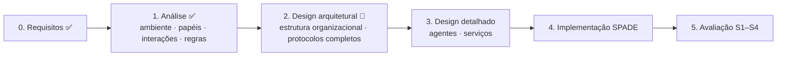

# Food Rescue Descentralizado

Sistema multiagente em **SPADE** para resgate e redistribuição de excedentes
alimentares **sem despachante central**. Tópico K do Assignment 1 de
*Introdução aos Sistemas Inteligentes e Autónomos* (FCUP/FEUP, 2026/27).

Metodologia: **Gaia** (Zambonelli, Jennings & Wooldridge, 2003).

## Estrutura

| Pasta / ficheiro | Conteúdo | Estado |
|---|---|---|
| [`docs/01-requisitos.md`](docs/01-requisitos.md) | Fase 0: objetivos, atores, RF/RNF, métricas, cenários | Revisto para o modelo v1 (armazém); a validar |
| [`docs/02-analise-gaia.md`](docs/02-analise-gaia.md) | Fase 1, análise Gaia: sub-organizações, ambiente, papéis, interações preliminares, regras organizacionais | Revisto para o modelo v1 (armazém); a validar |
| [`docs/03-interacoes-fipa.md`](docs/03-interacoes-fipa.md) | Speech Acts, FIPA-ACL, Contract Net; mapeamento para os nossos protocolos | Revisto para o modelo v1; proposta para o design |
| `v0/` | Protótipo de referência (exploração inicial do SPADE); **não é a implementação final** | Referência |
| [`v1/guia_v1.html`](v1/guia_v1.html) | Modelo v1, feito pelo grupo e mais simples: restaurantes como doadores, **um armazém** com zonas e operadores voluntários, ONGs e abrigos como receptores. Inclui o roteiro até ao código | Análise preliminar |
| [`v1/src/`](v1/src/README.md) | Implementação do grupo. **Fatia 1 pronta**: restaurante → ONG → resgatador (AnunciarOferta, ContratarResgate, EntregarLote). `python -m v1.src.main` | Em curso |

## Processo Gaia (Fig. 6 do artigo) e onde estamos

## Entrega

19–20 de novembro de 2026: código, documentação, relatório de desempenho e
apresentação com demo.
