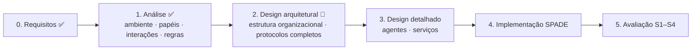

# Food Rescue Descentralizado

Sistema multiagente em **SPADE** para resgate e redistribuição de excedentes
alimentares **sem despachante central**. Tópico K do Assignment 1 de
*Introdução aos Sistemas Inteligentes e Autónomos* (FCUP/FEUP, 2026/27).

Metodologia: **Gaia** (Zambonelli, Jennings & Wooldridge, 2003).

## Estrutura

| Pasta / ficheiro | Conteúdo | Estado |
|---|---|---|
| [`docs/01-requisitos.md`](docs/01-requisitos.md) | Fase 0: objetivos, atores, RF/RNF, métricas, cenários | Rascunho a validar |
| [`docs/02-analise-gaia.md`](docs/02-analise-gaia.md) | Fase 1, análise Gaia: sub-organizações, ambiente, papéis, interações preliminares, regras organizacionais | Rascunho a validar |
| [`docs/03-interacoes-fipa.md`](docs/03-interacoes-fipa.md) | Speech Acts, FIPA-ACL, Contract Net; mapeamento para os nossos protocolos | Proposta para o design |
| `v0/` | Protótipo de referência (exploração inicial do SPADE); **não é a implementação final** | Referência |
| `src/` | Implementação do grupo | A fazer |

## Processo Gaia (Fig. 6 do artigo) e onde estamos

## Entrega

19–20 de novembro de 2026: código, documentação, relatório de desempenho e
apresentação com demo.
