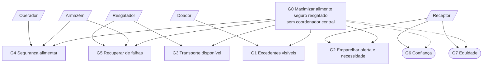

# 1. Requisitos — Food Rescue Descentralizado

> **Fase 0 do processo Gaia** (entrada da análise). O Gaia assume que os
> requisitos vêm de uma análise **orientada a objetivos** (Zambonelli et al.,
> 2003, §4.1): primeiro *quem* está envolvido e *o que* quer alcançar; só depois
> os requisitos concretos. Cada requisito aponta para o modelo Gaia que vai
> alimentar (coluna **→ Gaia**), para manter a rastreabilidade até ao código.
>
> **Versão v1 (modelo do armazém).** Em relação ao rascunho anterior, o modelo
> ficou mais simples: um **só tipo de doador** (restaurantes), **um armazém
> único** com zonas e operadores voluntários (em vez de várias geladeiras
> comunitárias), e **só ONGs e abrigos** como receptores. Ver
> [`../v1/guia_v1.html`](../v1/guia_v1.html).
>
> Estado: **rascunho para validação do grupo**. Os pontos marcados com ⚠️ são
> decisões que o grupo tem de confirmar ou alterar.

---

## 1.1 Problema e âmbito

Restaurantes deitam fora alimento ainda seguro porque não há forma rápida de o
fazer chegar a quem precisa antes de estragar. Queremos uma **rede
descentralizada** em que restaurantes, voluntários com veículo, um armazém de
alimentos (nos moldes do Banco Alimentar) e instituições receptoras se
coordenam **sem um despachante central**. O enunciado proíbe-o explicitamente:
*"without a central dispatcher"*.

| Dentro do âmbito | Fora do âmbito |
|---|---|
| Publicação de excedentes (lotes) e de necessidades | Pagamentos, faturação, benefícios fiscais |
| Emparelhamento oferta ↔ necessidade | Gestão interna de stock dos restaurantes |
| Contratação de transporte voluntário | Navegação GPS real (usamos uma grelha simplificada) |
| Armazém com zonas (seco, refrigerado, congelado) | Interface gráfica para utilizadores reais |
| Operadores voluntários dentro do armazém (receber, controlar estoque, preparar pedidos) | Dados pessoais de beneficiários finais |
| Perecibilidade e cadeia de frio | **Famílias como receptoras** (ficam para uma versão futura) |
| Cancelamentos, falhas e realocação | Outros doadores (padarias, supermercados) |
| Verificação da segurança alimentar e reputação local | |
| Simulação, métricas e cenários de teste | |

---

## 1.2 Modelo de objetivos

**G0: maximizar a quantidade de alimento seguro que chega a quem precisa antes
de expirar, sem coordenador central.**

| ID | Sub-objetivo | Tipo |
|---|---|---|
| G1 | Tornar os excedentes visíveis logo que surgem | *Hard goal* |
| G2 | Associar cada lote à necessidade mais adequada (categoria, quantidade, prazo) | *Hard goal* |
| G3 | Garantir transporte com voluntários disponíveis e capazes | *Hard goal* |
| G4 | Preservar a segurança alimentar (validade, cadeia de frio) | *Hard goal* |
| G5 | Recuperar de falhas (cancelamentos, ausências, zona do armazém avariada, falta de operadores, mensagens perdidas) | *Hard goal* |
| G6 | Promover confiança entre participantes (verificação, reputação local) | *Soft goal* |
| G7 | Distribuir de forma justa entre receptores | *Soft goal* |

*Hard goals* têm critério claro de cumprimento; *soft goals* são qualidades que
se maximizam (nomenclatura do Tropos, também nos materiais da cadeira).

*Retângulos: hard goals. Formas arredondadas a tracejado: soft goals.
Paralelogramos: atores que contribuem para o objetivo.*

---

## 1.3 Atores (stakeholders)

| Ator | Exemplos | Interesse próprio | Restrições |
|---|---|---|---|
| **Doador** | Restaurante | Escoar excedentes depressa e com pouco esforço | Janela de recolha curta (ex.: ao fecho) |
| **Resgatador** | Motorista de carro, ciclista, carrinha refrigerada | Recolhas compatíveis com o seu horário e trajeto | Capacidade (kg), com/sem caixa térmica, turno, pode desistir |
| **Armazém** (papel Armazenador) | Armazém nos moldes do Banco Alimentar | Não exceder a capacidade de cada zona, manter a temperatura | Zonas podem avariar; depende dos operadores para processar |
| **Operador** | Voluntário dentro do armazém | Tarefas compatíveis com o que sabe fazer e com o turno | Funções que domina, turno, pode desistir |
| **Receptor** | ONG, abrigo | Receber alimento adequado e a tempo | Categorias aceites, capacidade de receção, horário |

Os atores têm **interesses próprios** e **entram e saem** do sistema (um
voluntário acaba o turno, um restaurante só aparece ao fim do dia). No
vocabulário do Gaia (Zambonelli et al., 2003, §2.1) é um **sistema aberto**.
Por isso as regras organizacionais (análise §2.5) têm peso: não podemos confiar
que todos se comportam bem.

---

## 1.4 Requisitos funcionais

| ID | Requisito | Objetivo | → Gaia |
|---|---|---|---|
| RF01 | O doador publica uma oferta com categoria (seco, refrigerado, congelado), quantidade (kg), validade e janela de recolha | G1 | Ambiente, papéis |
| RF02 | O receptor publica a sua necessidade (categorias aceites, kg, janela de receção) | G2 | Ambiente, papéis |
| RF03 | As ofertas chegam aos pares relevantes **sem diretório central** (ex.: por vizinhança geográfica) | G1, G2 | Interações, regras |
| RF04 | A escolha do resgatador considera distância, capacidade, caixa térmica e disponibilidade | G3 | Papéis, interações |
| RF05 | O destino (receptor direto ou armazém) é escolhido conforme a adequação, a distância e o tempo de vida restante | G2, G4 | Papéis, regras |
| RF06 | O armazém aceita ou recusa um lote conforme a capacidade **da zona** da categoria, o estado da zona e a disponibilidade de operadores | G4 | Ambiente, interações |
| RF07 | Um cancelamento (de doador, resgatador, operador ou receptor) desencadeia realocação automática | G5 | Interações, regras |
| RF08 | O estado do alimento é verificado na recolha e na entrega (temperatura, kg, aspeto, validade) | G4, G6 | Papéis, regras |
| RF09 | Cada participante mantém uma reputação **local** dos pares com quem interagiu | G6 | Papéis |
| RF10 | A atribuição tem em conta o histórico já recebido por cada receptor | G7 | Regras |
| RF11 | O armazém volta a oferecer o estoque (aos receptores) antes de expirar | G2, G4 | Papéis, interações |
| RF12 | Itens expirados ou inseguros são descartados e registados, nunca entregues | G4 | Regras |
| RF13 | Os operadores voluntários executam as tarefas internas do armazém (receber e armazenar, controlar estoque, preparar pedido) escolhendo tarefas de um quadro, conforme as suas funções e o turno | G4, G5 | Papéis, interações |
| RF14 | Se uma zona avariar, o armazém oferece de imediato o estoque dessa zona | G4, G5 | Interações, regras |

## 1.5 Requisitos não funcionais

| ID | Requisito | Critério mensurável | → Gaia |
|---|---|---|---|
| RNF01 | **Descentralização:** nenhum agente decide destinos por outros nem tem visão global; o armazém é um **serviço de armazenagem**, não um coordenador | Com o armazém indisponível, doadores e receptores continuam a trocar lotes diretamente | Estrutura organizacional (design) |
| RNF02 | **Robustez:** o sistema continua com perda de mensagens e saída de agentes | Taxa de resgate em S3 ≥ 70% da de S1 ⚠️ | Interações, regras |
| RNF03 | **Escalabilidade:** o custo de mensagens cresce ~linearmente com o nº de agentes | Mensagens/entrega estável ao duplicar a população | Estrutura organizacional |
| RNF04 | **Latência:** lotes urgentes são emparelhados rapidamente | Emparelhamento < 30 min simulados ⚠️ | Regras (liveness) |
| RNF05 | **Privacidade:** receptores partilham só a necessidade agregada, sem dados pessoais | Nenhuma mensagem contém dados de pessoas | Ambiente, permissões |
| RNF06 | **Reprodutibilidade:** simulações parametrizáveis com *seed* fixa | Mesma *seed* → mesmos eventos gerados | Implementação |

> **Nota sobre o RNF01.** Com um armazém único, existe um ponto sensível: se
> ele falhar, perde-se a capacidade de armazenar. A defesa é de arquitetura: o
> armazém **não decide** destinos nem transportes, e o doador pode sempre
> oferecer **direto** aos receptores. A medição está em S3 (zona avariada) e
> numa variante com o armazém indisponível. ⚠️ Confirmar com o professor que
> esta leitura de "sem despachante central" é aceite.

## 1.6 Pressupostos de domínio

Estes pressupostos entram diretamente no **modelo de ambiente** (análise §2.2).

| Aspeto | Pressuposto |
|---|---|
| Categorias de conservação | **Seco** (vida de dias), **refrigerado** (vida de horas, no máximo 60 min fora do frio ⚠️), **congelado** (vida de dias, precisa de caixa térmica no transporte). Valores iniciais: seco 3 dias, refrigerado 6 h, congelado 7 dias |
| Armazém | Um local, três zonas com capacidade em kg (inicial: seco 500, refrigerado 200, congelado 100). Cada zona só guarda a sua categoria e pode avariar |
| Operadores | 4 voluntários com turno e 1 ou 2 funções cada (receber e armazenar · controlar estoque · preparar pedido). Duração inicial: 10 · 5 · 15 min |
| Veículos | Carro (≈30 km/h, 60 kg), bicicleta (≈15 km/h, 15 kg); uma fração tem caixa térmica |
| Resgatadores | Têm turnos; aceitam e podem desistir (com aviso) ou não aparecer (sem aviso) |
| Geração de excedentes | Estocástica, com **pico ao fecho** dos restaurantes |
| Necessidade dos receptores | Renova-se ao longo do dia. ONGs aceitam volumes maiores; abrigos precisam de refeições e perecíveis (diferença só de parâmetros) |
| Espaço | Grelha abstrata de 10×10 km com distância Manhattan ⚠️ |
| Comunicação | Mensagens assíncronas, podem perder-se |

## 1.7 Métricas de desempenho

| Métrica | Fórmula / definição | Objetivo medido |
|---|---|---|
| Taxa de resgate | kg entregues ÷ kg oferecidos | G0 |
| Desperdício | kg expirados ou rejeitados (por motivo) | G4 |
| Tempo oferta → entrega | média em min simulados | G2, RNF04 |
| Violações da cadeia de frio | nº de lotes refrigerados fora do frio > limite | G4 |
| Taxa de recuperação | lotes entregues após ≥1 falha ÷ lotes com falha | G5 |
| Km por kg entregue | km percorridos ÷ kg entregues | G3 (eficiência) |
| Equidade | Índice de Jain sobre kg recebidos por receptor | G7 |
| Custo de coordenação | mensagens ÷ entrega concluída | RNF03 |
| **Ocupação das zonas** | média de ocupado ÷ capacidade, por zona | G4 |
| **Espera no armazém** | tempo médio entre a chegada de um lote e o fim da tarefa "receber e armazenar" | G4, G5 |
| **Utilização dos operadores** | tempo ocupado ÷ tempo em turno | G5 |

## 1.8 Cenários de teste

| Cenário | Descrição | Trade-off que expõe |
|---|---|---|
| **S1: dia normal** | Oferta, resgatadores e operadores equilibrados | Linha de base |
| **S2: pico com escassez** | Muitos lotes ao fim do dia, ~40% dos resgatadores e poucos operadores | O **gargalo do armazém**: lotes à espera de operador, rapidez vs. equidade |
| **S3: falhas em cascata** | 30% de cancelamentos, a zona refrigerada avaria, operador falta, 5% de mensagens perdidas | Robustez dos protocolos de realocação; risco de concentrar o frio num só local |
| **S4: participantes pouco fiáveis** | Doadores com rotulagem errada, resgatadores que aceitam e não aparecem | Valor da verificação e da reputação local |

O enunciado pede pelo menos 3 cenários contrastantes. S4 é um extra.

## 1.9 Decisões

> **Fechadas em 13/11/2026.** Linha geral, sugerida pelo professor: primeiro um
> trabalho **simples, mas completo e coerente**; os detalhes só entram depois de o
> ecossistema funcionar. D6, D7 e D8 estão fechadas como se descreve abaixo. As
> outras seguem a proposta.

| # | Questão | Proposta | Alternativa | Porquê a proposta |
|---|---|---|---|---|
| D1 | Espaço | Grelha abstrata 10×10 km | Grafo do Porto | Mais simples de simular e explicar; o foco é a coordenação, não o mapa |
| D2 | Escala | 5 restaurantes, 6 resgatadores, 1 armazém, 4 operadores, 3 ONGs, 2 abrigos | Mais agentes | Corre num portátil com SPADE; depois testar escalabilidade a ×2 |
| D3 | Tempo | 1 min simulado = 0,05 s reais (dia de 8 h ≈ 30 s) | Tempo real | Permite várias *seeds* por cenário |
| D4 | Verificação | **Não agentificar**: papel VERIFICADOR desempenhado por quem recebe o lote | Agente Inspetor | Um inspetor central seria um ponto central; ver análise §2.2 |
| D5 | Limites de RNF02 e RNF04 | 70% e 30 min | Outros valores | Valores de referência para discutir no relatório |
| D6 | Do armazém ao receptor, quem transporta | ✅ **Decidido:** um resgatador, via o mesmo `ContratarResgate` (o armazém faz de doador) | O receptor retira por conta própria | Menos código: reaproveita um protocolo |
| D7 | Operadores | ✅ **Decidido:** não são agentes. OPERADOR é um papel desempenhado pelo agente Armazém, com N operadores internos (cada um com as funções que sabe fazer) e uma duração por tarefa | Agentes que pegam tarefas de um quadro (extra, se houver tempo) | Em Gaia, papel ≠ agente. Mantém o gargalo de S2 sem um protocolo a mais |
| D8 | Reputação | ✅ **Decidido:** fica, mas local a cada agente; sem troca de testemunhos (o professor citou-a) | Troca de testemunhos (extra) | Mantém o modelo pequeno |

## 1.10 Rastreabilidade (requisito → análise)

| Requisito | Elemento da análise Gaia |
|---|---|
| RF01, RF02 | Recursos `Lote[i]`, `Necessidade[r]`; papéis DOADOR, RECEPTOR |
| RF03 | Regra organizacional OS1 (sem visão global); protocolos AnunciarNecessidade, AnunciarOferta |
| RF04 | Papel ORGANIZADOR DE TRANSPORTE; protocolo ContratarResgate |
| RF05, RF10 | Papel EMPARELHADOR (atividade <ins>EscolherDestino</ins>); regra OL4 |
| RF06, RF11, RF14 | Papel ARMAZENADOR; protocolos AnunciarOferta (responde e inicia), TratarImprevisto; recurso `Zona[z]` |
| RF07 | Protocolo TratarImprevisto; regra OL2 |
| RF08, RF12 | Papel VERIFICADOR; regras OS3, OS4, OS5 |
| RF09 | Papel AVALIADOR (conhecimento local `Reputação[self][*]`) |
| RF13 | Papel OPERADOR (desempenhado pelo agente Armazém, D7); atividade interna DistribuirTarefas |
| RNF01 | Regra OS1 |
| RNF05 | Permissões de RECEPTOR; regra OS7 |

## Referências

- Zambonelli, F., Jennings, N. R., & Wooldridge, M. (2003). *Developing Multiagent Systems: The Gaia Methodology*. ACM TOSEM, 12(3), 317–370.
- Bresciani, P. et al. (2004). *Tropos: An Agent-Oriented Software Development Methodology*. AAMAS, 8, 203–236.
- Enunciado do Assignment 1, tópico K.
