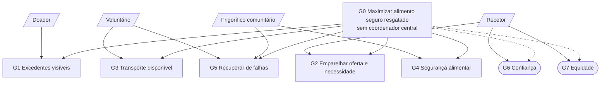

# 1. Requisitos — Food Rescue Descentralizado

> **Fase 0 do processo Gaia** (entrada da análise). O Gaia assume que os
> requisitos vêm de uma análise **orientada a objetivos** (Zambonelli et al.,
> 2003, §4.1): primeiro *quem* está envolvido e *o que* quer alcançar; só depois
> os requisitos concretos. Cada requisito aponta para o modelo Gaia que vai
> alimentar (coluna **→ Gaia**), para manter a rastreabilidade até ao código.
>
> Estado: **rascunho para validação do grupo**. Os pontos marcados com ⚠️ são
> decisões que o grupo tem de confirmar ou alterar.

---

## 1.1 Problema e âmbito

Restaurantes, supermercados e padarias deitam fora alimento ainda seguro porque
não há forma rápida de o fazer chegar a quem precisa antes de estragar.
Queremos uma **rede descentralizada** em que doadores, voluntários com veículo,
frigoríficos comunitários e instituições recetoras se coordenam **sem um
despachante central**. O enunciado proíbe-o explicitamente: *"without a central
dispatcher"*.

| Dentro do âmbito | Fora do âmbito |
|---|---|
| Publicação de excedentes e de necessidades | Pagamentos, faturação, benefícios fiscais |
| Emparelhamento oferta ↔ necessidade | Gestão interna de stock dos doadores |
| Contratação de transporte voluntário | Navegação GPS real (usamos um espaço simplificado) |
| Armazenamento temporário em frigoríficos comunitários | Interface gráfica para utilizadores reais |
| Perecibilidade e cadeia de frio | Dados pessoais de beneficiários finais |
| Cancelamentos, falhas e realocação | |
| Verificação da segurança alimentar e reputação | |
| Simulação, métricas e cenários de teste | |

---

## 1.2 Modelo de objetivos

**G0: maximizar a quantidade de alimento seguro que chega a quem precisa antes
de expirar, sem coordenador central.**

| ID | Sub-objetivo | Tipo |
|---|---|---|
| G1 | Tornar os excedentes visíveis logo que surgem | *Hard goal* |
| G2 | Associar cada excedente à necessidade mais adequada (tipo, quantidade, urgência, prazo) | *Hard goal* |
| G3 | Garantir transporte com voluntários disponíveis e capazes | *Hard goal* |
| G4 | Preservar a segurança alimentar (validade, cadeia de frio) | *Hard goal* |
| G5 | Recuperar de falhas (cancelamentos, ausências, frigorífico cheio ou avariado, mensagens perdidas) | *Hard goal* |
| G6 | Promover confiança entre participantes (verificação, reputação) | *Soft goal* |
| G7 | Distribuir de forma justa entre recetores | *Soft goal* |

*Hard goals* têm critério claro de cumprimento; *soft goals* são qualidades que
se maximizam (nomenclatura do Tropos, também nos materiais da cadeira).

*Retângulos: hard goals. Formas arredondadas a tracejado: soft goals.
Paralelogramos: atores que contribuem para o objetivo.*

---

## 1.3 Atores (stakeholders)

| Ator | Exemplos | Interesse próprio | Restrições |
|---|---|---|---|
| **Doador** | Restaurante, supermercado, padaria | Escoar excedentes depressa e com pouco esforço | Janela de recolha curta (ex.: ao fecho) |
| **Voluntário** | Motorista de carro, ciclista, carrinha refrigerada | Recolhas compatíveis com o seu horário e trajeto | Capacidade (kg), com/sem frio, turno, pode desistir |
| **Frigorífico comunitário** | Frigorífico de bairro, banco alimentar | Não exceder capacidade, manter temperatura | Pode avariar |
| **Recetor** | Associação, abrigo, cantina social | Receber alimento adequado e a tempo | Tipos aceites, capacidade de receção, horário |

Os atores têm **interesses próprios** e **entram e saem** do sistema (um
voluntário acaba o turno, um doador só aparece ao fim do dia). No vocabulário
do Gaia (Zambonelli et al., 2003, §2.1) é um **sistema aberto**. Por isso as
regras organizacionais (análise §2.5) têm peso: não podemos confiar que todos
se comportam bem.

---

## 1.4 Requisitos funcionais

| ID | Requisito | Objetivo | → Gaia |
|---|---|---|---|
| RF01 | O doador publica uma oferta com tipo, quantidade (kg), classe de conservação, validade e janela de recolha | G1 | Ambiente, papéis |
| RF02 | O recetor publica a sua necessidade (tipos aceites, kg, urgência, janela de receção) | G2 | Ambiente, papéis |
| RF03 | As ofertas chegam aos pares relevantes **sem diretório central** (ex.: por vizinhança geográfica) | G1, G2 | Interações, regras |
| RF04 | A escolha do voluntário considera distância, capacidade, equipamento de frio e disponibilidade | G3 | Papéis, interações |
| RF05 | O destino (recetor direto ou frigorífico intermédio) é escolhido conforme o tempo de vida restante | G2, G4 | Papéis, regras |
| RF06 | O frigorífico aceita ou recusa um depósito conforme capacidade e estado (temperatura, avaria) | G4 | Ambiente, interações |
| RF07 | Um cancelamento (de doador, voluntário ou recetor) desencadeia realocação automática | G5 | Interações, regras |
| RF08 | O estado do alimento é verificado na recolha e na entrega (temperatura, aspeto, validade) | G4, G6 | Papéis, regras |
| RF09 | Cada participante mantém uma reputação **local** dos pares com quem interagiu | G6 | Papéis |
| RF10 | A atribuição tem em conta o histórico já recebido por cada recetor | G7 | Regras |
| RF11 | O frigorífico volta a oferecer o que guarda antes de expirar | G2, G4 | Papéis, interações |
| RF12 | Itens expirados ou inseguros são descartados e registados, nunca entregues | G4 | Regras |

## 1.5 Requisitos não funcionais

| ID | Requisito | Critério mensurável | → Gaia |
|---|---|---|---|
| RNF01 | **Descentralização:** nenhum agente é ponto único de falha nem tem visão global | Remover qualquer agente não pára o sistema | Estrutura organizacional (design) |
| RNF02 | **Robustez:** o sistema continua com perda de mensagens e saída de agentes | Taxa de resgate em S3 ≥ 70% da de S1 ⚠️ | Interações, regras |
| RNF03 | **Escalabilidade:** o custo de mensagens cresce ~linearmente com o nº de agentes | Mensagens/entrega estável ao duplicar a população | Estrutura organizacional |
| RNF04 | **Latência:** ofertas urgentes são emparelhadas rapidamente | Emparelhamento < 30 min simulados ⚠️ | Regras (liveness) |
| RNF05 | **Privacidade:** recetores partilham só a necessidade agregada, sem dados pessoais | Nenhuma mensagem contém dados de pessoas | Ambiente, permissões |
| RNF06 | **Reprodutibilidade:** simulações parametrizáveis com *seed* fixa | Mesma *seed* → mesmos eventos gerados | Implementação |

## 1.6 Pressupostos de domínio

Estes pressupostos entram diretamente no **modelo de ambiente** (análise §2.2).

| Aspeto | Pressuposto |
|---|---|
| Classes de conservação | **Ambiente** (pão, enlatados): vida de 6 a 15 h. **Refrigerado** (pratos, lacticínios): 2,5 a 6 h, com no máximo 1 h fora do frio ⚠️. **Congelado**: fora do âmbito inicial |
| Veículos | Carro (≈30 km/h, 60 kg), bicicleta (≈15 km/h, 15 kg); uma fração tem frio |
| Voluntários | Têm turnos; aceitam e podem desistir (com aviso) ou não aparecer (sem aviso) |
| Frigoríficos | Capacidade em kg; podem avariar (perdem-se os refrigerados) |
| Geração de excedentes | Estocástica, com **pico ao fecho** das lojas e em feriados |
| Necessidade dos recetores | Renova-se ao longo do dia (as pessoas continuam a comer) |
| Espaço | Grelha abstrata de 10×10 km com distância Manhattan ⚠️ |
| Comunicação | Mensagens assíncronas, podem perder-se |

## 1.7 Métricas de desempenho

| Métrica | Fórmula / definição | Objetivo medido |
|---|---|---|
| Taxa de resgate | kg entregues ÷ kg oferecidos | G0 |
| Desperdício | kg expirados ou rejeitados (por motivo) | G4 |
| Tempo oferta → entrega | média em min simulados | G2, RNF04 |
| Violações da cadeia de frio | nº de itens refrigerados fora do frio > limite | G4 |
| Taxa de recuperação | itens entregues após ≥1 falha ÷ itens com falha | G5 |
| Km por kg entregue | km percorridos ÷ kg entregues | G3 (eficiência) |
| Equidade | Índice de Jain sobre kg recebidos por recetor | G7 |
| Custo de coordenação | mensagens ÷ entrega concluída | RNF03 |

## 1.8 Cenários de teste

| Cenário | Descrição | Trade-off que expõe |
|---|---|---|
| **S1: dia normal** | Oferta e voluntários equilibrados | Linha de base |
| **S2: pico com escassez** | Muitos excedentes ao fim do dia, ~40% dos voluntários | Rapidez vs. equidade; frigoríficos como *buffer* |
| **S3: falhas em cascata** | 30% cancelamentos, um frigorífico avaria, 5% mensagens perdidas | Robustez dos protocolos de realocação |
| **S4: participantes pouco fiáveis** | Doadores com rotulagem errada, voluntários que aceitam e não aparecem | Valor da verificação e da reputação |

O enunciado pede pelo menos 3 cenários contrastantes. S4 é um extra.

## 1.9 Decisões em aberto ⚠️ (fechar na próxima reunião)

| # | Questão | Proposta | Alternativa | Porquê a proposta |
|---|---|---|---|---|
| D1 | Espaço | Grelha abstrata 10×10 km | Grafo do Porto | Mais simples de simular e explicar; o foco é a coordenação, não o mapa |
| D2 | Escala | 10 doadores, 15 voluntários, 3 frigoríficos, 8 recetores | Mais agentes | Corre num portátil com SPADE; depois testar escalabilidade a ×2 |
| D3 | Tempo | 1 min simulado = 0,05 s reais (dia de 8 h ≈ 30 s) | Tempo real | Permite várias *seeds* por cenário |
| D4 | Verificação | **Não agentificar**: papel VERIFICADOR desempenhado por quem recebe o alimento | Agente Inspetor | Um inspetor central seria um ponto central; ver análise §2.2 |
| D5 | Limites de RNF02 e RNF04 | 70% e 30 min | Outros valores | Valores de referência para discutir no relatório |

## 1.10 Rastreabilidade (requisito → análise)

| Requisito | Elemento da análise Gaia |
|---|---|
| RF01, RF02 | Recursos `Oferta[i]`, `Necessidade[r]`; papéis DOADOR, RECETOR |
| RF03 | Regra organizacional OS1 (sem visão global); protocolos AnunciarExcedente, DeclararNecessidade |
| RF04 | Papel ORGANIZADOR DE TRANSPORTE; protocolo PedirTransporte |
| RF05, RF10 | Papel EMPARELHADOR (atividade <ins>EscolherDestino</ins>); regra OL4 |
| RF06, RF11 | Papel ARMAZENADOR; protocolos PedirDepósito, AnunciarExcedente |
| RF07 | Protocolo DesistirTransporte; regra OL2 |
| RF08, RF12 | Papel VERIFICADOR; regras OS3, OS4, OS5 |
| RF09 | Papel AVALIADOR; conhecimento local `Reputação[self][*]` |
| RNF01 | Regra OS1 |
| RNF05 | Permissões de RECETOR; regra OS7 |

## Referências

- Zambonelli, F., Jennings, N. R., & Wooldridge, M. (2003). *Developing Multiagent Systems: The Gaia Methodology*. ACM TOSEM, 12(3), 317–370.
- Bresciani, P. et al. (2004). *Tropos: An Agent-Oriented Software Development Methodology*. AAMAS, 8, 203–236.
- Enunciado do Assignment 1, tópico K.
