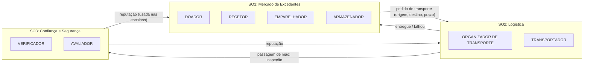
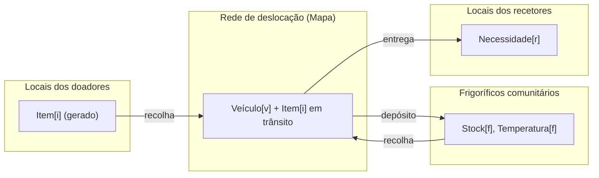
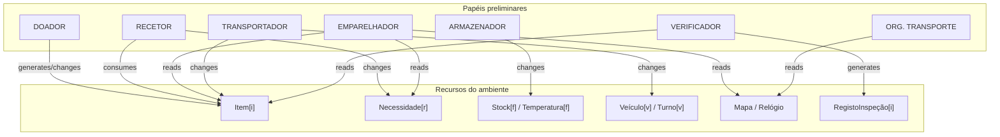
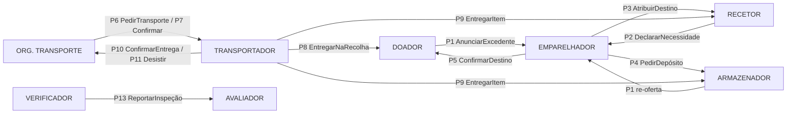

# 2. Análise Gaia — Food Rescue Descentralizado

> **Fase 1 do processo Gaia** (Zambonelli, Jennings & Wooldridge, 2003, §4.1,
> Fig. 6). A análise organiza os requisitos em **cinco produtos**, todos
> **independentes da estrutura organizacional**, que só se escolhe no design
> arquitetural:
>
> | § | Produto | Pergunta a que responde |
> |---|---|---|
> | 2.1 | Sub-organizações | O sistema divide-se em grupos com objetivos próprios? |
> | 2.2 | Modelo de ambiente | Que recursos existem, onde, e o que se pode fazer com eles? |
> | 2.3 | Modelo de papéis preliminar | Que *competências* são precisas, seja qual for a estrutura? |
> | 2.4 | Modelo de interações preliminar | Que *interações* essas competências exigem? |
> | 2.5 | Regras organizacionais | Que propriedades a organização **toda** tem de respeitar? |
>
> Ideia-chave: **papel ≠ agente**. Um papel é uma competência (ex.: "verificar
> alimento"). Só no design decidimos que agentes desempenham que papéis. O mesmo
> agente pode desempenhar vários papéis, e o mesmo papel pode ser desempenhado
> por vários tipos de agente.
>
> Estado: **rascunho para validação do grupo** (⚠️ = decisão a confirmar).

---

## 2.1 Sub-organizações

O Gaia diz que se justifica uma sub-organização quando uma parte do sistema
(i) persegue um sub-objetivo próprio, (ii) interage pouco com o resto e
(iii) exige competências que não são precisas noutras partes (§4.1.1).

| Sub-organização | Sub-objetivos | (i) Sub-objetivo próprio | (ii) Interação com o resto | (iii) Competências específicas |
|---|---|---|---|---|
| **SO1: Mercado de Excedentes** | G1, G2, G7 | Decidir *para onde* vai cada excedente | Entrega à SO2 um pedido "levar X de A para B" | Avaliar compatibilidade, urgência, equidade |
| **SO2: Logística** | G3, G5 | Garantir que *alguém leva* o item a tempo | Recebe pedidos da SO1, devolve "entregue" ou "falhou" | Rotas, capacidade, frio, turnos, realocação |
| **SO3: Confiança e Segurança** | G4, G6 | Garantir que o que chega é *seguro* e que se aprende quem é fiável | Recebe resultados de inspeção nas passagens de mão | Inspeção, avaliação de reputação |



**Notas.**
- As fronteiras são de *competência*, não de agente. Um frigorífico participa
  na SO1, como destino e como quem volta a oferecer, e na SO2, como ponto de
  passagem.
- ⚠️ Alternativa a discutir: tratar tudo como **uma única organização**. É
  defensável pelo tamanho do problema. Propomos três porque separa claramente
  os três tipos de mecanismo que o enunciado pede: emparelhamento,
  encaminhamento, e verificação com reputação.

---

## 2.2 Modelo de ambiente

O ambiente é modelado como **recursos computacionais abstratos** que os agentes
podem ler (*sensing*), alterar (*effecting*) ou consumir (§4.1.2). Juntamos o
qualificador **generates** do artigo original do Gaia (Wooldridge et al., 2000)
para recursos criados por um papel.

### 2.2.1 Lista de recursos

| Recurso | Conteúdo | Localização | Dinâmica própria (muda sem ninguém agir) |
|---|---|---|---|
| `Relógio` | tempo simulado | global | avança |
| `Mapa` | grelha 10×10 km, distâncias Manhattan, velocidade por tipo de veículo | global | — |
| `Item[i]` | tipo, kg, classe (ambiente/refrigerado), validade, janela de recolha, **posição**, **tempo acumulado fora do frio**, condição/rótulo | no doador → veículo → frigorífico/recetor | validade aproxima-se; tempo fora do frio cresce se não estiver no frio |
| `Necessidade[r]` | tipos aceites, kg pretendidos, urgência, janela de receção (só agregados) | no recetor `r` | renova-se ao longo do dia |
| `Stock[f]` | itens guardados, capacidade, temperatura, estado (ok/avariado) | no frigorífico `f` | pode avariar; itens expiram |
| `Temperatura[f]` | leitura do sensor do frigorífico | no frigorífico `f` | varia; dispara com avaria |
| `Veículo[v]` | posição, carga atual, capacidade, tem frio? | móvel | — |
| `Turno[v]` | janelas de disponibilidade do voluntário | com o voluntário | entra e sai de turno |
| `RegistoInspeção[i]` | resultado das verificações de um item (ok / expirado / frio / rótulo) | onde foi inspecionado | — |
| `Canal` | meio de comunicação entre agentes | global | perde mensagens com probabilidade *p* |

### 2.2.2 Notação Gaia (estilo FUSION, como no artigo)

```text
reads     Relógio                   // tempo simulado
          Mapa                      // distâncias e tempos de deslocação
          Turno[v]                  // disponibilidade do voluntário v
          Temperatura[f]            // sensor do frigorífico f
changes   Item[i].estado            // posição, tempo fora do frio, condição
          Necessidade[r]            // pedido agregado do recetor r
          Stock[f]                  // conteúdo e ocupação do frigorífico f
          Veículo[v]                // posição e carga
generates Item[i]                   // um doador cria um novo excedente
          RegistoInspeção[i]        // cada inspeção cria um registo
consumes  Item[i]                   // entregue para consumo ou descartado
```

### 2.2.3 Distribuição espacial dos recursos

O ambiente é **distribuído**: ninguém tem acesso a todos os recursos (como
na Fig. 7 do artigo). Cada `Item[i]` está num sítio físico e só quem lá está
o pode inspecionar ou mover.



### 2.2.4 Decisões "agentificar ou não" (§4.1.2, final)

O artigo dá um critério. Um componente que só **fornece dados** fica como
recurso. Um que **toma decisões complexas** ou envolve **humanos no circuito**
deve ser **agentificado**.

| Componente | Decisão | Justificação |
|---|---|---|
| Sensor de temperatura do frigorífico | **Recurso** (`Temperatura[f]`) | Só fornece dados |
| Mapa, relógio | **Recurso** | Só fornecem dados |
| Frigorífico comunitário | **Agentificar** | Decide aceitar ou recusar depósitos, decide quando voltar a oferecer o stock, reage a avarias (RF06, RF11) |
| Inspetor de segurança alimentar | **Não agentificar** ⚠️ (D4) | Um inspetor dedicado seria um ponto central e um gargalo; a verificação passa a **papel** VERIFICADOR, desempenhado por quem recebe o alimento |
| Voluntário, doador, recetor | **Agentificar** | Humanos no circuito, com interesses próprios |

---

## 2.3 Modelo de papéis preliminar

Os papéis seguem o modelo de *role schema* do artigo (Fig. 9):
**Descrição**, **Protocolos e Atividades**, **Permissões** e
**Responsabilidades** (*liveness* e *safety*).

**Como ler as expressões de *liveness*** (Tabela I do artigo):

| Operador | Significado |
|---|---|
| `x . y` | x seguido de y |
| `x \| y` | x ou y |
| `x*` | x zero ou mais vezes |
| `x+` | x uma ou mais vezes |
| `xω` | x repetido indefinidamente |
| `[x]` | x é opcional |
| `x ‖ y` | x e y intercalados (em paralelo) |

Convenção do artigo: **atividades sublinhadas** (<ins>assim</ins>; trabalho
interno, sem falar com ninguém) e protocolos sem sublinhado (envolvem
interação). Em cada papel podem decorrer **várias instâncias em paralelo**,
uma por item.

---

### PAPEL: DOADOR *(SurplusProvider)*: SO1

**Descrição.** Representa quem tem excedentes (restaurante, supermercado,
padaria). Deteta um excedente, descreve-o com rigor, torna-o visível à rede e
entrega-o a quem o vier buscar. Pode cancelar a oferta.

**Protocolos e atividades.** AnunciarExcedente, ConfirmarDestino,
EntregarNaRecolha, CancelarOferta · <ins>DetetarExcedente</ins>,
<ins>DescreverItem</ins>, <ins>DescartarItem</ins>

**Permissões.**
```text
generates Item[i]               // cria a descrição do excedente
changes   Item[i].estado        // só enquanto o item está no doador
reads     Relógio
```

**Liveness.**
DOADOR = ( <ins>DetetarExcedente</ins> . <ins>DescreverItem</ins> . AnunciarExcedente . [ConfirmarDestino] . ( EntregarNaRecolha | CancelarOferta | <ins>DescartarItem</ins> ) )<sup>ω</sup>

**Safety.**
- Só anuncia itens com `validade(i) − agora > tempo mínimo de resgate`.
- A descrição anunciada corresponde ao estado real (`rótulo(i)` verdadeiro). Num sistema aberto isto **não se pode garantir**, por isso existe o VERIFICADOR.

---

### PAPEL: RECETOR *(NeedHolder)*: SO1

**Descrição.** Instituição que distribui alimento (associação, abrigo,
cantina). Mantém e declara a sua necessidade **agregada**, responde a
propostas de alimento e recebe entregas.

**Protocolos e atividades.** DeclararNecessidade, AtribuirDestino (como
parceiro), CancelarNecessidade, EntregarItem (como parceiro) ·
<ins>AtualizarNecessidade</ins>, <ins>Distribuir</ins>

**Permissões.**
```text
changes  Necessidade[r]         // só a sua própria
reads    Item[i]                // descrição dos itens propostos
consumes Item[i]                // quando aceita uma entrega
```

**Liveness.**
RECETOR = ( <ins>AtualizarNecessidade</ins> . DeclararNecessidade )<sup>ω</sup> ‖ ( AtribuirDestino . [CancelarNecessidade] )<sup>ω</sup> ‖ ( EntregarItem . <ins>Distribuir</ins> )<sup>ω</sup>

**Safety.**
- `kg reservados + kg a caminho ≤ capacidade de receção`.
- `Necessidade[r]` nunca contém dados pessoais de beneficiários (RNF05).

---

### PAPEL: ARMAZENADOR *(Storekeeper)*: SO1 / SO2

**Descrição.** Guarda temporariamente alimento num frigorífico comunitário
quando não há recetor imediato. Aceita ou recusa depósitos, vigia o estado
do frigorífico e volta a oferecer o stock antes de expirar.

**Protocolos e atividades.** PedirDepósito (como parceiro), EntregarItem
(como parceiro), AnunciarExcedente (re-oferta), EntregarNaRecolha ·
<ins>MonitorizarEstado</ins>, <ins>VerificarValidades</ins>, <ins>DescartarItem</ins>

**Permissões.**
```text
reads    Temperatura[f]
changes  Stock[f]
consumes Item[i]                // descarte de itens expirados
```

**Liveness.**
ARMAZENADOR = ( <ins>MonitorizarEstado</ins> )<sup>ω</sup> ‖ ( PedirDepósito . [EntregarItem] )<sup>ω</sup> ‖ ( <ins>VerificarValidades</ins> . [ AnunciarExcedente . EntregarNaRecolha | <ins>DescartarItem</ins> ] )<sup>ω</sup>

**Safety.**
- `ocupação(f) ≤ capacidade(f)`.
- `Temperatura[f] ≤ 5 °C` enquanto houver refrigerados em stock ⚠️.
- `estado(f) = avariado ⇒` recusa todos os depósitos.

---

### PAPEL: EMPARELHADOR *(Matcher)*: SO1

**Descrição.** Competência de decidir **para onde vai** cada excedente:
recetor direto ou frigorífico (RF05). Tem em conta compatibilidade,
urgência, quantidade, tempo de vida restante e equidade (RF10).
**Na análise ainda não sabemos quem desempenha este papel.** Pode ser o
próprio doador, o recetor, ou ambos em negociação. Isso decide-se no design
arquitetural.

**Protocolos e atividades.** AnunciarExcedente (como parceiro),
DeclararNecessidade (como parceiro), AtribuirDestino, PedirDepósito ·
<ins>FiltrarCompatíveis</ins>, <ins>CalcularPrioridade</ins>, <ins>EscolherDestino</ins>

**Permissões.**
```text
reads  Item[i]                  // descrição anunciada
       Necessidade[r]           // SÓ dos recetores na sua vizinhança
       Mapa, Relógio
       Reputação[self][*]       // conhecimento local
```
O que **não** pode fazer também é permissão: não lê necessidades de toda a
rede (RNF01, regra OS1).

**Liveness.**
EMPARELHADOR = ( AnunciarExcedente . <ins>FiltrarCompatíveis</ins> . <ins>CalcularPrioridade</ins> . <ins>EscolherDestino</ins> . ( AtribuirDestino | PedirDepósito )<sup>+</sup> )<sup>ω</sup> ‖ ( DeclararNecessidade )<sup>ω</sup>

*(o `+` cobre a tentativa seguinte quando o destino escolhido recusa)*

**Safety.**
- Cada item tem **no máximo um destino** atribuído em cada instante.
- `tipo(i) ∈ tiposAceites(r)` para o recetor escolhido.
- Só atribui se `agora + tempo estimado de entrega < validade(i)`.

---

### PAPEL: ORGANIZADOR DE TRANSPORTE *(TripAssigner)*: SO2

**Descrição.** Competência de conseguir que **alguém leve** o item da origem
ao destino a tempo, escolhendo entre voluntários disponíveis (RF04), e de
**realocar** se o escolhido desistir ou não aparecer (RF07).
Tal como no EMPARELHADOR, quem o desempenha decide-se no design ⚠️.

**Protocolos e atividades.** PedirTransporte, ConfirmarTransporte,
DesistirTransporte (como parceiro), ConfirmarEntrega (como parceiro) ·
<ins>EstimarViabilidade</ins>, <ins>SelecionarTransportador</ins>, <ins>DetetarAusência</ins>

**Permissões.**
```text
reads  Item[i], Mapa, Relógio
       Reputação[self][*]
```

**Liveness.**
ORGANIZADOR_TRANSPORTE = ( <ins>EstimarViabilidade</ins> . ( PedirTransporte . <ins>SelecionarTransportador</ins> . ConfirmarTransporte . [ DesistirTransporte | <ins>DetetarAusência</ins> ] )<sup>+</sup> . ConfirmarEntrega )<sup>ω</sup>

**Safety.**
- Cada item tem **no máximo um transportador** confirmado em cada instante.
- Itens refrigerados só são atribuídos a quem tem frio **ou** consegue entregar dentro do limite fora do frio.

---

### PAPEL: TRANSPORTADOR *(Carrier)*: SO2

**Descrição.** Voluntário com veículo. Propõe-se para recolhas compatíveis
com o seu turno, posição e capacidade. Recolhe, transporta preservando a
conservação e entrega. Pode desistir, e deve avisar quando o faz.

**Protocolos e atividades.** PedirTransporte (como parceiro),
ConfirmarTransporte (como parceiro), EntregarNaRecolha (como parceiro),
EntregarItem, DesistirTransporte, ConfirmarEntrega · <ins>PlanearRota</ins>,
<ins>Deslocar</ins>, <ins>ManterConservação</ins>

**Permissões.**
```text
reads    Mapa, Turno[v]          // só o seu turno
changes  Veículo[v]              // só o seu veículo
         Item[i].estado          // só durante o transporte
```

**Liveness.**
TRANSPORTADOR = ( PedirTransporte . [ ConfirmarTransporte . ( <ins>PlanearRota</ins> . <ins>Deslocar</ins> . EntregarNaRecolha . <ins>ManterConservação</ins> . <ins>Deslocar</ins> . EntregarItem . ConfirmarEntrega | DesistirTransporte ) ] )<sup>ω</sup>

**Safety.**
- `carga(v) ≤ capacidade(v)`.
- `refrigerado(i) ∧ ¬frio(v) ⇒ tempo fora do frio(i) ≤ 60 min` ⚠️.
- Só aceita transportes dentro do seu `Turno[v]`.

---

### PAPEL: VERIFICADOR *(Inspector)*: SO3

**Descrição.** Inspeciona o alimento **em cada passagem de mão** (recolha e
entrega): validade, tempo fora do frio, aspeto e rótulo (RF08). Regista o
resultado e comunica-o. É desempenhado por **quem recebe** o item: o
transportador na recolha, e o recetor ou o frigorífico na entrega (D4).

**Protocolos e atividades.** ReportarInspeção · <ins>InspecionarItem</ins>,
<ins>RegistarResultado</ins>

**Permissões.**
```text
reads     Item[i].estado, Relógio
generates RegistoInspeção[i]
```

**Liveness.**
VERIFICADOR = ( <ins>InspecionarItem</ins> . <ins>RegistarResultado</ins> . ReportarInspeção )<sup>ω</sup>

**Safety.**
- `validade(i) < agora ∨ violação de frio(i) ⇒` o item é rejeitado (nunca aceite para consumo).

---

### PAPEL: AVALIADOR *(ReputationKeeper)*: SO3

**Descrição.** Mantém a reputação **local** dos pares com quem houve
interação (RF09), atualizada a partir de inspeções, entregas confirmadas,
desistências e ausências. Desempenhado por todos os participantes.

**Protocolos e atividades.** ReportarInspeção (como parceiro),
ConfirmarEntrega (como parceiro), DesistirTransporte (como parceiro),
[PartilharReputação] · <ins>AtualizarReputação</ins>, <ins>ConsultarReputação</ins>

**Permissões.**
```text
reads    RegistoInspeção[i]     // só das interações em que participou
changes  Reputação[self][*]     // conhecimento local (não é recurso do ambiente)
```

**Liveness.**
AVALIADOR = ( ( ReportarInspeção | ConfirmarEntrega | DesistirTransporte ) . <ins>AtualizarReputação</ins> )<sup>ω</sup> ‖ ( <ins>ConsultarReputação</ins> )<sup>ω</sup> ‖ [ PartilharReputação ]<sup>ω</sup>

**Safety.**
- `0 ≤ Reputação[self][j] ≤ 1`.
- Só altera a **sua** opinião. Opiniões alheias, se partilhadas, contam com peso menor ⚠️.

---

### 2.3.1 Diagrama ambiente ↔ papéis (como a Fig. 8 do artigo)



O EMPARELHADOR precisa de ler `Stock[f]` para saber se há espaço, mas
`Stock[f]` só pode ser alterado pelo ARMAZENADOR. Segundo o artigo (§4.1.3),
quando um papel precisa de um recurso a que não tem acesso direto, faz-se
**por mediação** de quem tem. Daí surge o protocolo **PedirDepósito**.

---

## 2.4 Modelo de interações preliminar

Cada protocolo é definido pelos atributos do artigo (§4.1.4): **nome,
iniciador, parceiro, inputs, outputs, descrição**. Nesta fase **não** se
define a sequência de mensagens; isso faz-se no design, com AUML.
O "??" indica que o parceiro depende da estrutura organizacional, tal como na
Fig. 11 do artigo.

| # | Protocolo | Iniciador | Parceiro | Inputs | Outputs | Descrição |
|---|---|---|---|---|---|---|
| P1 | **AnunciarExcedente** | DOADOR, ARMAZENADOR | EMPARELHADOR (??: recetores vizinhos? um pequeno grupo?) | descrição de `Item[i]` | interesse / destino proposto | Torna um excedente visível aos pares relevantes, sem diretório central (RF01, RF03, RF11) |
| P2 | **DeclararNecessidade** | RECETOR | EMPARELHADOR (??) | `Necessidade[r]` agregada | confirmação | Torna a necessidade conhecida na vizinhança (RF02) |
| P3 | **AtribuirDestino** | EMPARELHADOR | RECETOR | item, kg, prazo de entrega | aceita / recusa | Propõe um item concreto a um recetor, que reserva capacidade se aceitar (RF05, RF10) |
| P4 | **PedirDepósito** | EMPARELHADOR | ARMAZENADOR | item, kg, classe, prazo | aceita / recusa | Reserva espaço num frigorífico quando não há recetor imediato (RF05, RF06) |
| P5 | **ConfirmarDestino** | EMPARELHADOR | DOADOR / ARMAZENADOR | destino escolhido | — | Informa quem tem o item para onde ele vai |
| P6 | **PedirTransporte** | ORG. TRANSPORTE | TRANSPORTADOR (??: todos os vizinhos? só alguns?) | origem, destino, kg, frio?, prazo | proposta (tempo estimado, capacidade, frio) / recusa | Encontra quem consegue fazer a recolha a tempo (RF04) |
| P7 | **ConfirmarTransporte** | ORG. TRANSPORTE | TRANSPORTADOR | transporte escolhido | compromisso | Fecha o acordo; os outros candidatos são libertados |
| P8 | **EntregarNaRecolha** | TRANSPORTADOR | DOADOR / ARMAZENADOR | identificação do transporte | item + `RegistoInspeção` | Passagem de mão na origem; inclui inspeção (RF08) |
| P9 | **EntregarItem** | TRANSPORTADOR | RECETOR / ARMAZENADOR | item, tempo fora do frio | aceite / rejeitado (+ motivo) | Passagem de mão no destino; inclui inspeção (RF08, RF12) |
| P10 | **ConfirmarEntrega** | TRANSPORTADOR | ORG. TRANSPORTE, DOADOR | resultado | — | Fecha o ciclo do item e alimenta a reputação |
| P11 | **DesistirTransporte** | TRANSPORTADOR | ORG. TRANSPORTE | motivo | — | Aviso de cancelamento, que desencadeia realocação (RF07) |
| P12 | **CancelarOferta / CancelarNecessidade** | DOADOR / RECETOR | quem tiver reserva ou compromisso | id | — | Liberta reservas (RF07) |
| P13 | **ReportarInspeção** | VERIFICADOR | AVALIADOR (e quem tiver interesse no item) | `RegistoInspeção[i]` | — | Leva o resultado da inspeção a quem avalia (RF08, RF09) |
| P14 | **PartilharReputação** *(opcional)* | AVALIADOR | AVALIADOR (vizinho) | opinião sobre *j* | opinião sobre *j* | Troca de testemunhos para acelerar a aprendizagem ⚠️ |

**Falha sem protocolo.** Um voluntário que **não aparece** (sem avisar) não
inicia protocolo nenhum. Por isso o ORGANIZADOR DE TRANSPORTE tem a atividade
<ins>DetetarAusência</ins>, por *timeout*. Convém mencionar isto na
apresentação: é um caso que só um sistema aberto tem.



---

## 2.5 Regras organizacionais

São responsabilidades da **organização como um todo**, e não de um papel
(§4.1.5). Dividem-se em *liveness* (como a organização evolui) e *safety*
(invariantes).

### Liveness (OL)

| ID | Regra | Leitura | Requisito |
|---|---|---|---|
| OL1 | AnunciarExcedente(i) → AtribuirDestino(i) \| PedirDepósito(i) → PedirTransporte(i) → EntregarNaRecolha(i) → EntregarItem(i) | Cada item segue esta ordem; não há transporte sem destino | RF01–RF06 |
| OL2 | ( DesistirTransporte(i) \| <ins>DetetarAusência</ins>(i) ) ∧ validade(i) > agora → PedirTransporte(i) | Uma falha de transporte leva **sempre** a uma nova tentativa, enquanto o item for seguro | RF07, G5 |
| OL3 | EntregarItem(i) → <ins>InspecionarItem</ins>(i) → ReportarInspeção(i) → <ins>AtualizarReputação</ins> | Toda a entrega é inspecionada, e toda a inspeção alimenta a reputação | RF08, RF09 |
| OL4 | Necessidade[r] > 0 ∧ existe oferta compatível na vizinhança de *r* → AtribuirDestino(·, r) acaba por ocorrer | Nenhum recetor com necessidade fica eternamente esquecido (sem *starvation*) | RF10, G7 |
| OL5 | ARMAZENADOR: EntregarItem(i) → ( AnunciarExcedente(i) \| <ins>DescartarItem</ins>(i) ) | O que entra no frigorífico volta a ser oferecido ou é descartado; nunca fica esquecido | RF11 |

### Safety (OS)

| ID | Regra | Leitura | Requisito |
|---|---|---|---|
| OS1 | EMPARELHADOR<sup>2..N</sup>, ORGANIZADOR_TRANSPORTE<sup>2..N</sup>; nenhuma entidade lê `Necessidade[r]` de todos os *r* | Estes papéis são desempenhados por **várias** entidades, cada uma com visão **local**. É a tradução Gaia de "sem despachante central" | RNF01, RF03 |
| OS2 | ∀i: \|destino(i)\| ≤ 1 ∧ \|transportador(i)\| ≤ 1 | Um item nunca está prometido a dois sítios nem a dois voluntários ao mesmo tempo | G2, G3 |
| OS3 | ¬( TRANSPORTADOR(i) ‖ VERIFICADOR<sub>entrega</sub>(i) ) e ¬( DOADOR(i) ‖ VERIFICADOR<sub>recolha</sub>(i) ) | **Separação de funções**: quem entrega um item não certifica a própria entrega, e o doador não certifica o próprio alimento | RF08, G6 |
| OS4 | ∀i refrigerado: tempo fora do frio(i) ≤ 60 min ⚠️ | Cadeia de frio | G4 |
| OS5 | ∀i entregue para consumo: agora ≤ validade(i) ∧ inspeção(i) = ok | Nunca se entrega alimento expirado ou inseguro | RF12, G4 |
| OS6 | ∀v: carga(v) ≤ capacidade(v); ∀f: ocupação(f) ≤ capacidade(f) | Limites físicos | RF04, RF06 |
| OS7 | Nenhuma mensagem contém dados pessoais; `Necessidade[r]` é sempre agregada | Privacidade | RNF05 |

---

## 2.6 O que fica para o design arquitetural (fase 2)

A análise deixou propositadamente em aberto:

1. **Quem desempenha EMPARELHADOR e ORGANIZADOR DE TRANSPORTE.** Opções:
   (a) o próprio doador (mercado: o doador leiloa o item);
   (b) o recetor (o recetor procura e reclama ofertas);
   (c) negociação entre ambos. A escolha define a **estrutura organizacional**.
   O enunciado e a regra OS1 excluem a hierarquia com controlador central
   (Fig. 3 do artigo), e apontam para um **coletivo de pares** com mecanismo
   de mercado (ex.: *Contract Net*, Smith 1980).
2. **Os "??" dos protocolos P1, P2 e P6**: a quem se anuncia (raio
   geográfico? os *k* mais próximos?).
3. **A sequência de mensagens** de cada protocolo (diagramas AUML) e as
   *performatives* FIPA-ACL a usar (cfp, propose, accept-proposal,
   inform, failure…).
4. **O mapeamento papel → tipo de agente** (modelo de agentes) e os serviços
   de cada agente (modelo de serviços).

Os pontos 1–3 já têm uma proposta em [03-interacoes-fipa.md](03-interacoes-fipa.md).

## 2.7 Checklist de validação (para a reunião do grupo)

- [ ] Concordamos com as 3 sub-organizações (ou passamos a 1)?
- [ ] Faltam recursos no ambiente? (ex.: janelas horárias dos recetores)
- [ ] Cada RF da secção 1.4 aparece em pelo menos um papel, protocolo ou regra?
- [ ] Os valores ⚠️ (60 min fora do frio, 5 °C, peso das opiniões partilhadas) estão bem?
- [ ] D4: a verificação fica como papel (proposta) ou agente inspetor?
- [ ] Cada membro consegue explicar 2 papéis e 3 regras na apresentação?

## Referências

- Zambonelli, F., Jennings, N. R., & Wooldridge, M. (2003). *Developing Multiagent Systems: The Gaia Methodology*. ACM TOSEM, 12(3), 317–370. (§4.1, Fig. 6–12, Tabela I)
- Wooldridge, M., Jennings, N. R., & Kinny, D. (2000). *The Gaia Methodology for Agent-Oriented Analysis and Design*. AAMAS, 3, 285–312. (qualificador *generates*)
- Smith, R. G. (1980). *The Contract Net Protocol*. IEEE Transactions on Computers, C-29(12).
