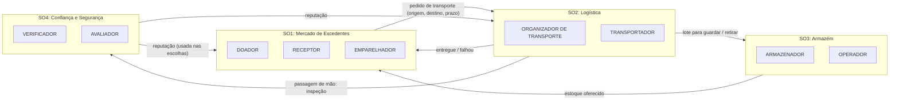
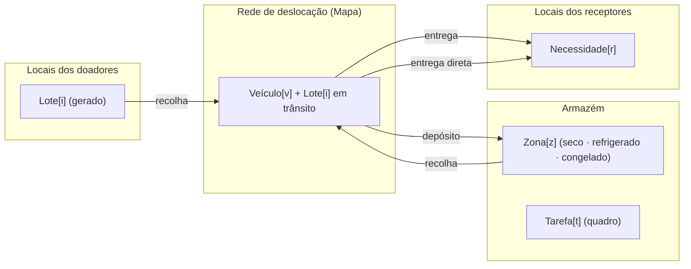
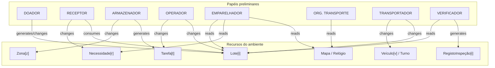
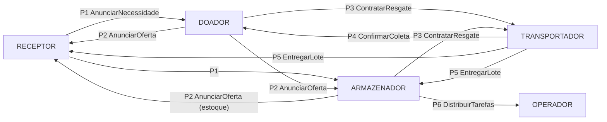

# 2. Análise Gaia — Food Rescue Descentralizado

> **Fase 1 do processo Gaia** (Zambonelli, Jennings & Wooldridge, 2003, §4.1,
> Fig. 6). A análise organiza os requisitos em **cinco produtos**, todos
> **independentes da estrutura organizacional**, que só se escolhe no design
> arquitetural:
>
> | § | Produto | Pergunta a que responde |
> |---|---|---|
> | 2.1 | Sub-organizações | O sistema divide-se em grupos com objetivos próprios? |
> | 2.2 | Modelo de ambiente | Que recursos existem, onde, e o que se pode fazer com eles? |
> | 2.3 | Modelo de papéis preliminar | Que *competências* são precisas, seja qual for a estrutura? |
> | 2.4 | Modelo de interações preliminar | Que *interações* essas competências exigem? |
> | 2.5 | Regras organizacionais | Que propriedades a organização **toda** tem de respeitar? |
>
> Ideia-chave: **papel ≠ agente**. Um papel é uma competência (ex.: "verificar
> alimento"). Só no design decidimos que agentes desempenham que papéis. O mesmo
> agente pode desempenhar vários papéis, e o mesmo papel pode ser desempenhado
> por vários tipos de agente.
>
> **Versão v1 (modelo do armazém).** Um só tipo de doador (restaurante), **um
> armazém** com zonas e operadores voluntários, receptores = ONGs e abrigos.
> Resumo visual em [`../v1/guia_v1.html`](../v1/guia_v1.html). O guia usa
> cinco nomes de papel (Doador, Receptor, Resgatador, Armazenador, Operador);
> aqui os separamos em competências mais finas, como o Gaia pede, e a §2.3.2
> faz a correspondência.
>
> Estado: **rascunho para validação do grupo** (⚠️ = decisão a confirmar).

---

## 2.1 Sub-organizações

O Gaia diz que se justifica uma sub-organização quando uma parte do sistema
(i) persegue um sub-objetivo próprio, (ii) interage pouco com o resto e
(iii) exige competências que não são precisas noutras partes (§4.1.1).

| Sub-organização | Sub-objetivos | (i) Sub-objetivo próprio | (ii) Interação com o resto | (iii) Competências específicas |
|---|---|---|---|---|
| **SO1: Mercado de Excedentes** | G1, G2, G7 | Decidir *para onde* vai cada lote | Entrega à SO2 um pedido "levar X de A para B" | Avaliar compatibilidade, validade, equidade |
| **SO2: Logística** | G3, G5 | Garantir que *alguém leva* o lote a tempo | Recebe pedidos da SO1, devolve "entregue" ou "falhou" | Rotas, capacidade, caixa térmica, turnos, realocação |
| **SO3: Armazém** | G4, G5 | Guardar com segurança e processar com os operadores | Recebe lotes da SO2, volta a oferecer estoque à SO1 | Zonas, temperatura, inventário, tarefas internas |
| **SO4: Confiança e Segurança** | G4, G6 | Garantir que o que chega é *seguro* e que se aprende quem é fiável | Recebe resultados de inspeção nas passagens de mão | Inspeção, avaliação de reputação |



**Notas.**
- As fronteiras são de *competência*, não de agente. O armazém participa na
  SO1 (como destino e como quem volta a oferecer) e na SO2 (como ponto de
  passagem), e os seus operadores formam uma sub-organização própria, com
  protocolo interno (DistribuirTarefas).
- ⚠️ Alternativa a discutir: tratar tudo como **uma única organização**. É
  defensável pelo tamanho do problema. Propomos quatro porque separa os
  mecanismos que o enunciado pede: emparelhamento, encaminhamento,
  armazenagem e verificação com reputação.

---

## 2.2 Modelo de ambiente

O ambiente é modelado como **recursos computacionais abstratos** que os agentes
podem ler (*sensing*), alterar (*effecting*) ou consumir (§4.1.2). Juntamos o
qualificador **generates** do artigo original do Gaia (Wooldridge et al., 2000)
para recursos criados por um papel.

### 2.2.1 Lista de recursos

| Recurso | Conteúdo | Localização | Dinâmica própria (muda sem ninguém agir) |
|---|---|---|---|
| `Relógio` | tempo simulado | global | avança |
| `Mapa` | grelha 10×10 km, coordenadas (x, y), distância Manhattan, velocidade por tipo de veículo | global | — |
| `Lote[i]` | categoria (seco · refrigerado · congelado), kg, validade, janela de recolha, **posição**, **tempo acumulado fora do frio**, estado | no doador → veículo → armazém/receptor | validade aproxima-se; tempo fora do frio cresce se não estiver no frio |
| `Necessidade[r]` | categorias aceites, kg pretendidos, janela de receção (só agregados) | no receptor `r` | renova-se ao longo do dia |
| `Zona[z]` | tipo, capacidade em kg, ocupação, temperatura, estado (ok/avariada), inventário | no armazém | pode avariar; os lotes expiram |
| `Tarefa[t]` | tipo (receber · controlar · preparar), lote, duração, prazo, responsável | no quadro de tarefas do armazém | o prazo aproxima-se; volta ao quadro se o responsável desistir |
| `Veículo[v]` | posição, carga atual, capacidade, caixa térmica? | móvel | — |
| `Turno[v]` / `Turno[o]` | janelas de disponibilidade do resgatador / operador | com o voluntário | entra e sai de turno |
| `RegistoInspeção[i]` | resultado das verificações de um lote (ok / expirado / frio / rótulo / kg) | onde foi inspecionado | — |
| `Canal` | meio de comunicação entre agentes | global | perde mensagens com probabilidade *p* |

### 2.2.2 Notação Gaia (estilo FUSION, como no artigo)

```text
reads     Relógio                   // tempo simulado
          Mapa                      // distâncias e tempos de deslocação
          Turno[v], Turno[o]        // disponibilidade dos voluntários
changes   Lote[i].estado            // posição, tempo fora do frio, condição
          Necessidade[r]            // pedido agregado do receptor r
          Zona[z]                   // ocupação, temperatura e inventário da zona z
          Tarefa[t]                 // estado e responsável da tarefa t
          Veículo[v]                // posição e carga
generates Lote[i]                   // um doador cria um novo excedente
          Tarefa[t]                 // o armazém cria tarefas internas
          RegistoInspeção[i]        // cada inspeção cria um registo
consumes  Lote[i]                   // entregue para consumo ou descartado
```

### 2.2.3 Distribuição espacial dos recursos

O ambiente é **distribuído**: ninguém tem acesso a todos os recursos (como na
Fig. 7 do artigo). Cada `Lote[i]` está num sítio físico e só quem lá está o
pode inspecionar ou mover. As `Zona[z]` e as `Tarefa[t]` vivem dentro do
armazém e só ele as altera.



### 2.2.4 Decisões "agentificar ou não" (§4.1.2, final)

O artigo dá um critério. Um componente que só **fornece dados** fica como
recurso. Um que **toma decisões complexas** ou envolve **humanos no circuito**
deve ser **agentificado**.

| Componente | Decisão | Justificação |
|---|---|---|
| Sensor de temperatura de cada zona | **Recurso** (parte de `Zona[z]`) | Só fornece dados |
| Mapa, relógio, quadro de tarefas | **Recurso** | Só fornecem dados |
| Armazém | **Agentificar** (um agente) | Decide aceitar ou recusar lotes por zona, quando voltar a oferecer estoque, reage a avarias (RF06, RF11, RF14). As zonas são recursos dele, não agentes |
| Operador | **Agentificar** ⚠️ (D7) | Humano no circuito, escolhe tarefas conforme função e turno. *Fallback*: reduzir a um número de operadores e um tempo por tarefa |
| Inspetor de segurança alimentar | **Não agentificar** ⚠️ (D4) | Um inspetor dedicado seria um ponto central e um gargalo; a verificação passa a **papel** VERIFICADOR, desempenhado por quem recebe o lote |
| Resgatador, doador, receptor | **Agentificar** | Humanos no circuito, com interesses próprios |

---

## 2.3 Modelo de papéis preliminar

Os papéis seguem o modelo de *role schema* do artigo (Fig. 9):
**Descrição**, **Protocolos e Atividades**, **Permissões** e
**Responsabilidades** (*liveness* e *safety*).

**Como ler as expressões de *liveness*** (Tabela I do artigo):

| Operador | Significado |
|---|---|
| `x . y` | x seguido de y |
| `x \| y` | x ou y |
| `x*` | x zero ou mais vezes |
| `x+` | x uma ou mais vezes |
| `xω` | x repetido indefinidamente |
| `[x]` | x é opcional |
| `x ‖ y` | x e y intercalados (em paralelo) |

Convenção do artigo: **atividades sublinhadas** (<ins>assim</ins>; trabalho
interno, sem falar com ninguém) e protocolos sem sublinhado (envolvem
interação). Em cada papel podem decorrer **várias instâncias em paralelo**,
uma por lote.

---

### PAPEL: DOADOR *(SurplusProvider)*: SO1

**Descrição.** Representa o restaurante. Deteta um excedente, descreve-o com
rigor (lote), torna-o visível à rede e entrega-o a quem o vier buscar. Pode
cancelar a oferta.

**Protocolos e atividades.** AnunciarOferta, ContratarResgate (como
parceiro, para o seu lote), ConfirmarColeta, TratarImprevisto ·
<ins>AvaliarExcedente</ins>, <ins>LotearEEmbalar</ins>,
<ins>DefinirPrazoMáximo</ins>, <ins>DescartarLote</ins>

**Permissões.**
```text
generates Lote[i]               // cria a descrição do excedente
changes   Lote[i].estado        // só enquanto o lote está no doador
reads     Relógio, Mapa, Necessidade[r] (dos que conhece)
```

**Liveness.**
DOADOR = ( <ins>AvaliarExcedente</ins> . <ins>LotearEEmbalar</ins> . <ins>DefinirPrazoMáximo</ins> . AnunciarOferta . [ContratarResgate . ConfirmarColeta] . ( ConfirmarEntrega | TratarImprevisto | <ins>DescartarLote</ins> ) )<sup>ω</sup>

**Safety.**
- Só anuncia lotes com `validade(i) − agora > tempo mínimo útil`.
- A descrição anunciada corresponde ao estado real (categoria e kg verdadeiros). Num sistema aberto isto **não se pode garantir**, por isso existe o VERIFICADOR.
- No máximo um contrato de transporte ativo por lote.

---

### PAPEL: RECEPTOR *(NeedHolder)*: SO1

**Descrição.** ONG ou abrigo. Mantém e declara a sua necessidade **agregada**,
responde a ofertas e recebe entregas. A diferença entre ONG e abrigo está só
nos parâmetros (categorias aceites, volume).

**Protocolos e atividades.** AnunciarNecessidade, AnunciarOferta (como
respondente), EntregarLote (como parceiro), TratarImprevisto ·
<ins>AvaliarNecessidade</ins>, <ins>InspecionarLote</ins>

**Permissões.**
```text
changes  Necessidade[r]         // só a sua própria
reads    Lote[i]                // descrição dos lotes propostos
consumes Lote[i]                // quando aceita uma entrega
```

**Liveness.**
RECEPTOR = ( <ins>AvaliarNecessidade</ins> . AnunciarNecessidade )<sup>ω</sup> ‖ ( AnunciarOferta . [TratarImprevisto] )<sup>ω</sup> ‖ ( EntregarLote . <ins>InspecionarLote</ins> )<sup>ω</sup>

**Safety.**
- `kg reservados + kg a caminho + kg recebidos ≤ necessidade declarada` (e ≤ capacidade de receção).
- `Necessidade[r]` nunca contém dados pessoais de beneficiários (RNF05).
- Só confirma a entrega depois de receber.

---

### PAPEL: ARMAZENADOR *(Storekeeper)*: SO3

**Descrição.** O armazém como entidade da rede. Aceita ou recusa lotes por
zona, guarda, vigia a temperatura e volta a oferecer o estoque antes de
expirar. **Não decide destinos por ninguém**: quando oferece estoque, comporta-se
como um doador. O trabalho físico é feito pelos OPERADORES, através do quadro
de tarefas.

**Protocolos e atividades.** AnunciarNecessidade (como respondente),
AnunciarOferta (responde e inicia), ContratarResgate (inicia, para estoque),
ConfirmarColeta, EntregarLote (como parceiro), DistribuirTarefas (inicia),
TratarImprevisto · <ins>ConferirCapacidadeDaZona</ins>,
<ins>MonitorarTemperatura</ins>, <ins>GerirInventário</ins>,
<ins>DescartarVencidos</ins>

**Permissões.**
```text
reads    Relógio, Necessidade[r] (dos que conhece)
changes  Zona[z]                // ocupação, temperatura, inventário
         Lote[i].estado         // armazenado · em preparo · descartado
generates Tarefa[t]
consumes Lote[i]                // descarte de lotes expirados
```

**Liveness.**
ARMAZENADOR = ( <ins>MonitorarTemperatura</ins> )<sup>ω</sup> ‖ ( AnunciarOferta<sub>resp</sub> . [EntregarLote . DistribuirTarefas] )<sup>ω</sup> ‖ ( <ins>GerirInventário</ins> . [ AnunciarOferta<sub>inic</sub> . ContratarResgate . ConfirmarColeta | <ins>DescartarVencidos</ins> ] )<sup>ω</sup>

**Safety.**
- `ocupação(z) ≤ capacidade(z)` para cada zona.
- Um lote só entra na zona da sua categoria.
- Só reserva vaga se houver operador previsto para receber dentro do prazo.
- `estado(z) = avariada ⇒` recusa todos os depósitos nessa zona e oferece de imediato o seu estoque (RF14).
- `Temperatura[z] ≤ 5 °C` na zona refrigerada enquanto houver lotes ⚠️.
- Nunca liberta lote vencido ou acima do limite fora do frio.

---

### PAPEL: OPERADOR *(WarehouseWorker)*: SO3

**Descrição.** Voluntário que trabalha dentro do armazém. Tem **funções que
sabe fazer** (receber e armazenar · controlar estoque · preparar pedido) e um
turno. Escolhe tarefas do quadro: o livre pega a mais urgente que sabe fazer.
Ninguém lhe atribui trabalho.

**Protocolos e atividades.** DistribuirTarefas (como parceiro),
TratarImprevisto · <ins>ReceberEArmazenar</ins>, <ins>ControlarEstoque</ins>,
<ins>PrepararPedido</ins>, <ins>AtualizarTurno</ins>

**Permissões.**
```text
reads    Tarefa[t] (quadro), Zona[z].inventário, Turno[o], Relógio
changes  Tarefa[t].estado       // só a que pegou
         Lote[i].estado         // só o que está a manusear
```

**Liveness.**
OPERADOR = ( <ins>AtualizarTurno</ins> )<sup>ω</sup> ‖ ( DistribuirTarefas . ( <ins>ReceberEArmazenar</ins> | <ins>ControlarEstoque</ins> | <ins>PrepararPedido</ins> ) . [TratarImprevisto] )<sup>ω</sup>

**Safety.**
- Só pega tarefa de função que sabe fazer e dentro do `Turno[o]`.
- Uma tarefa de cada vez.
- Se sair do turno ou desistir, devolve a tarefa ao quadro.
- Regista os kg e a temperatura que conferiu com honestidade.

---

### PAPEL: EMPARELHADOR *(Matcher)*: SO1

**Descrição.** Competência de decidir **para onde vai** cada lote: receptor
direto ou armazém (RF05). Tem em conta compatibilidade de categoria,
quantidade, tempo de vida restante, distância e equidade (RF10). **Na análise
ainda não sabemos quem desempenha este papel.** Pode ser o próprio doador (ou o
armazém, ao oferecer estoque), o receptor, ou ambos em negociação. Decide-se no
design arquitetural.

**Protocolos e atividades.** AnunciarOferta, AnunciarNecessidade (como
parceiro) · <ins>FiltrarCompatíveis</ins>, <ins>CalcularPrioridade</ins>,
<ins>EscolherDestino</ins>

**Permissões.**
```text
reads  Lote[i]                  // descrição anunciada
       Necessidade[r]           // SÓ dos receptores que conhece
       Mapa, Relógio
       Reputação[self][*]       // conhecimento local
```
O que **não** pode fazer também é permissão: não lê necessidades de toda a
rede (RNF01, regra OS1).

**Liveness.**
EMPARELHADOR = ( AnunciarOferta . <ins>FiltrarCompatíveis</ins> . <ins>CalcularPrioridade</ins> . <ins>EscolherDestino</ins> )<sup>+</sup> ‖ ( AnunciarNecessidade )<sup>ω</sup>

*(o `+` cobre a tentativa seguinte quando o destino escolhido recusa)*

**Safety.**
- Cada lote tem **no máximo um destino** atribuído em cada instante.
- `categoria(i) ∈ categoriasAceites(r)` para o receptor escolhido.
- Só atribui se `agora + tempo estimado de entrega < validade(i)`.

---

### PAPEL: ORGANIZADOR DE TRANSPORTE *(TripAssigner)*: SO2

**Descrição.** Competência de conseguir que **alguém leve** o lote da origem
ao destino a tempo, escolhendo entre resgatadores disponíveis (RF04), e de
**realocar** se o escolhido desistir ou não aparecer (RF07). Quem o desempenha
decide-se no design ⚠️ (proposta: quem tem o lote: doador ou armazém).

**Protocolos e atividades.** ContratarResgate, ConfirmarColeta, TratarImprevisto ·
<ins>EstimarViabilidade</ins>, <ins>SelecionarTransportador</ins>,
<ins>DetetarAusência</ins>

**Permissões.**
```text
reads  Lote[i], Mapa, Relógio
       Reputação[self][*]
```

**Liveness.**
ORGANIZADOR_TRANSPORTE = ( <ins>EstimarViabilidade</ins> . ( ContratarResgate . <ins>SelecionarTransportador</ins> . ConfirmarColeta . [ TratarImprevisto | <ins>DetetarAusência</ins> ] )<sup>+</sup> . EntregarLote )<sup>ω</sup>

**Safety.**
- Cada lote tem **no máximo um resgatador** confirmado em cada instante.
- Lotes refrigerados ou congelados só são atribuídos a quem tem caixa térmica **ou** consegue entregar dentro do limite fora do frio.

---

### PAPEL: TRANSPORTADOR *(Carrier)*: SO2

**Descrição.** O resgatador: voluntário com veículo. Propõe-se para recolhas
compatíveis com o seu turno, posição e capacidade. Recolhe, transporta
preservando a conservação e entrega ao receptor ou ao armazém. Pode desistir, e
deve avisar quando o faz.

**Protocolos e atividades.** ContratarResgate (como parceiro), ConfirmarColeta,
EntregarLote, TratarImprevisto · <ins>EstimarUtilidade</ins>,
<ins>CalcularRota</ins>, <ins>MonitorarTemperatura</ins>,
<ins>AtualizarDisponibilidade</ins>

**Permissões.**
```text
reads    Mapa, Turno[v]          // só o seu turno
changes  Veículo[v]              // só o seu veículo
         Lote[i].estado          // só durante o transporte
```

**Liveness.**
TRANSPORTADOR = ( ContratarResgate . [ ( <ins>CalcularRota</ins> . ConfirmarColeta . <ins>MonitorarTemperatura</ins> . EntregarLote ) | TratarImprevisto ] )<sup>ω</sup> ‖ ( <ins>AtualizarDisponibilidade</ins> )<sup>ω</sup>

**Safety.**
- `carga(v) ≤ capacidade(v)`.
- `refrigerado(i) ∧ ¬caixaTérmica(v) ⇒ tempo fora do frio(i) ≤ 60 min` ⚠️.
- Só aceita transportes dentro do seu `Turno[v]` e um de cada vez.
- Reporta temperatura e kg com honestidade; avisa o cancelamento assim que o decide.

---

### PAPEL: VERIFICADOR *(Inspector)*: SO4

**Descrição.** Inspeciona o alimento **em cada passagem de mão** (recolha e
entrega): validade, tempo fora do frio, kg, temperatura e rótulo (RF08).
Regista o resultado. É desempenhado por **quem recebe** o lote: o resgatador na
recolha, e o receptor ou o armazém na entrega (D4).

**Protocolos e atividades.** ConfirmarColeta, EntregarLote ·
<ins>InspecionarLote</ins>, <ins>RegistarResultado</ins>

**Permissões.**
```text
reads     Lote[i].estado, Relógio
generates RegistoInspeção[i]
```

**Liveness.**
VERIFICADOR = ( <ins>InspecionarLote</ins> . <ins>RegistarResultado</ins> )<sup>ω</sup>

**Safety.**
- `validade(i) < agora ∨ violação de frio(i) ⇒` o lote é rejeitado (nunca aceito para consumo).

---

### PAPEL: AVALIADOR *(ReputationKeeper)*: SO4

**Descrição.** Mantém a reputação **local** dos pares com quem houve interação
(RF09), atualizada a partir de inspeções, entregas confirmadas, desistências e
ausências. Desempenhado por todos os participantes. Nesta versão **não há troca
de testemunhos** entre agentes (ficaria como extra, D8).

**Protocolos e atividades.** ConfirmarColeta, EntregarLote e TratarImprevisto
(como observador) · <ins>AtualizarReputação</ins>, <ins>ConsultarReputação</ins>

**Permissões.**
```text
reads    RegistoInspeção[i]     // só das interações em que participou
changes  Reputação[self][*]     // conhecimento local (não é recurso do ambiente)
```

**Liveness.**
AVALIADOR = ( ( ConfirmarColeta | EntregarLote | TratarImprevisto ) . <ins>AtualizarReputação</ins> )<sup>ω</sup> ‖ ( <ins>ConsultarReputação</ins> )<sup>ω</sup>

**Safety.**
- `0 ≤ Reputação[self][j] ≤ 1`.
- Só altera a **sua** opinião.

---

### 2.3.1 Diagrama ambiente ↔ papéis (como a Fig. 8 do artigo)



O EMPARELHADOR precisa de saber se o armazém tem espaço, mas `Zona[z]` só pode
ser alterada pelo ARMAZENADOR. Segundo o artigo (§4.1.3), quando um papel
precisa de um recurso a que não tem acesso direto, faz-se **por mediação** de
quem tem: o armazém **responde** a AnunciarOferta com aceite ou recusa, e a
reserva da vaga faz parte dessa resposta.

### 2.3.2 Correspondência com os papéis do guia v1

| Guia v1 | Competências Gaia desta análise |
|---|---|
| Doador | DOADOR (+ EMPARELHADOR e ORGANIZADOR DE TRANSPORTE para os seus lotes) |
| Receptor | RECEPTOR (+ VERIFICADOR na entrega) |
| Resgatador | TRANSPORTADOR (+ VERIFICADOR na recolha) |
| Armazenador | ARMAZENADOR (+ EMPARELHADOR e ORGANIZADOR DE TRANSPORTE ao oferecer estoque; VERIFICADOR na receção) |
| Operador | OPERADOR |
| (todos) | AVALIADOR |

---

## 2.4 Modelo de interações preliminar

Cada protocolo é definido pelos atributos do artigo (§4.1.4): **nome,
iniciador, parceiro, inputs, outputs, descrição**. Nesta fase **não** se
define a sequência de mensagens; isso faz-se no design, com AUML.

| # | Protocolo | Iniciador | Parceiro | Inputs | Outputs | Descrição |
|---|---|---|---|---|---|---|
| P1 | **AnunciarNecessidade** | RECEPTOR | DOADOR, ARMAZENADOR (??: os que conhece por vizinhança) | `Necessidade[r]` agregada | necessidade conhecida | Torna a necessidade conhecida na vizinhança (RF02, RF03) |
| P2 | **AnunciarOferta** | DOADOR ou ARMAZENADOR | RECEPTOR, ARMAZENADOR (??: raio? os *k* mais próximos?) | descrição de `Lote[i]` | aceite (kg, janela, zona) / recusa; destino escolhido | Escolhe o destino de um lote ou de um item do estoque. O armazém só aceita se a zona tiver espaço e houver operador previsto, e aceitar **reserva** a vaga (RF01, RF03, RF05, RF06, RF11) |
| P3 | **ContratarResgate** | DOADOR ou ARMAZENADOR | TRANSPORTADOR (??: todos os conhecidos?) | lote, origem, destino, prazo | proposta (tempo, risco de frio) / recusa; contrato | Contract Net: encontra e fecha quem faz o transporte (RF04) |
| P4 | **ConfirmarColeta** | TRANSPORTADOR | DOADOR ou ARMAZENADOR | kg e temperatura declarados e medidos | coleta confirmada ou divergência | Passagem de mão na origem; inclui inspeção (RF08) |
| P5 | **EntregarLote** | TRANSPORTADOR | RECEPTOR ou ARMAZENADOR | lote, kg e temperatura na chegada | confirmada / parcial / recusada (+ motivo) | Passagem de mão no destino; inclui inspeção. No armazém gera uma tarefa "receber e armazenar" (RF08, RF12, RF13) |
| P6 | **DistribuirTarefas** | ARMAZENADOR | OPERADOR | tarefa (tipo, lote, prazo) | tarefa pega, depois concluída | Interno ao armazém: o operador livre, com a função certa e dentro do turno, pega a mais urgente (RF13) |
| P7 | **TratarImprevisto** | quem deteta | partes afetadas | tipo de evento, lote, contrato ou tarefa | contrato cancelado / redirecionado, tarefa devolvida, lote descartado | Reage a cancelamento, atraso, ausência, falta de operador ou falha de frio (RF07, RF14) |

**Falha sem protocolo.** Um resgatador (ou operador) que **não aparece** (sem
avisar) não inicia protocolo nenhum. Por isso o ORGANIZADOR DE TRANSPORTE tem a
atividade <ins>DetetarAusência</ins>, por *timeout*, e o armazém faz o mesmo
com as tarefas. Convém mencionar isto na apresentação: é um caso que só um
sistema aberto tem.



---

## 2.5 Regras organizacionais

São responsabilidades da **organização como um todo**, e não de um papel
(§4.1.5). Dividem-se em *liveness* (como a organização evolui) e *safety*
(invariantes).

### Liveness (OL)

| ID | Regra | Leitura | Requisito |
|---|---|---|---|
| OL1 | AnunciarOferta(i) → ContratarResgate(i) → ConfirmarColeta(i) → EntregarLote(i) | Cada lote segue esta ordem; não há transporte sem destino | RF01–RF06 |
| OL2 | ( TratarImprevisto(i) \| <ins>DetetarAusência</ins>(i) ) ∧ validade(i) > agora → ContratarResgate(i) | Uma falha de transporte leva **sempre** a uma nova tentativa, enquanto o lote for seguro | RF07, G5 |
| OL3 | EntregarLote(i) → <ins>InspecionarLote</ins>(i) → <ins>AtualizarReputação</ins> | Toda a entrega é inspecionada, e toda a inspeção alimenta a reputação local | RF08, RF09 |
| OL4 | Necessidade[r] > 0 ∧ existe oferta compatível na vizinhança de *r* → AnunciarOferta(·, r) acaba por resultar em aceite | Nenhum receptor com necessidade fica eternamente esquecido (sem *starvation*) | RF10, G7 |
| OL5 | ARMAZENADOR: EntregarLote(i) → ( AnunciarOferta(i) \| <ins>DescartarVencidos</ins>(i) ) | O que entra no armazém volta a ser oferecido ou é descartado; nunca fica esquecido | RF11 |
| OL6 | ARMAZENADOR: EntregarLote(i) → DistribuirTarefas(receber e armazenar) → tarefa concluída ∨ tarefa devolvida ao quadro | Toda a tarefa interna acaba concluída ou volta ao quadro; nenhum lote fica à espera de um operador que já saiu | RF13 |

### Safety (OS)

| ID | Regra | Leitura | Requisito |
|---|---|---|---|
| OS1 | EMPARELHADOR<sup>2..N</sup>, ORGANIZADOR_TRANSPORTE<sup>2..N</sup>; nenhuma entidade lê `Necessidade[r]` de todos os *r*; o armazém **não escolhe destinos por terceiros** | Estes papéis são desempenhados por **várias** entidades, cada uma com visão **local**. É a tradução Gaia de "sem despachante central". O armazém é serviço de armazenagem, não coordenador | RNF01, RF03 |
| OS2 | ∀i: \|destino(i)\| ≤ 1 ∧ \|transportador(i)\| ≤ 1 | Um lote nunca está prometido a dois sítios nem a dois resgatadores ao mesmo tempo | G2, G3 |
| OS3 | ¬( TRANSPORTADOR(i) ‖ VERIFICADOR<sub>entrega</sub>(i) ) e ¬( DOADOR(i) ‖ VERIFICADOR<sub>recolha</sub>(i) ) | **Separação de funções**: quem entrega um lote não certifica a própria entrega, e o doador não certifica o próprio alimento | RF08, G6 |
| OS4 | ∀i refrigerado ou congelado: tempo fora do frio(i) ≤ 60 min ⚠️ | Cadeia de frio | G4 |
| OS5 | ∀i entregue para consumo: agora ≤ validade(i) ∧ inspeção(i) = ok | Nunca se entrega alimento expirado ou inseguro | RF12, G4 |
| OS6 | ∀v: carga(v) ≤ capacidade(v); ∀z: ocupação(z) ≤ capacidade(z); ∀o: no máximo uma tarefa de cada vez | Limites físicos | RF04, RF06, RF13 |
| OS7 | Nenhuma mensagem contém dados pessoais; `Necessidade[r]` é sempre agregada | Privacidade | RNF05 |
| OS8 | ∀i na zona z: categoria(i) = tipo(z) | Cada zona só guarda a sua categoria | RF06 |

---

## 2.6 O que fica para o design arquitetural (fase 2)

A análise deixou propositadamente em aberto:

1. **Quem desempenha EMPARELHADOR e ORGANIZADOR DE TRANSPORTE.** Opções:
   (a) quem tem o lote (doador, ou armazém ao oferecer estoque), em mercado:
   essa entidade lança o Contract Net; (b) o receptor (procura e reclama
   ofertas); (c) negociação entre ambos. A escolha define a **estrutura
   organizacional**. O enunciado e a regra OS1 excluem a hierarquia com
   controlador central (Fig. 3 do artigo) e apontam para um **coletivo de
   pares** com mecanismo de mercado (ex.: *Contract Net*, Smith 1980).
2. **Os "??" dos protocolos P1, P2 e P3**: a quem se anuncia (raio
   geográfico? os *k* mais próximos?).
3. **A sequência de mensagens** de cada protocolo (diagramas AUML) e as
   *performatives* FIPA-ACL a usar (cfp, propose, accept-proposal,
   inform, failure…).
4. **O mapeamento papel → tipo de agente** (modelo de agentes) e os serviços
   de cada agente (modelo de serviços). Proposta: `Restaurante`, `Resgatador`,
   `Armazem`, `Operador`, `ONG`, `Abrigo`.
5. **O modo de falha do armazém** (RNF01): como medir a robustez com o
   armazém indisponível.

Os pontos 1–3 já têm uma proposta em [03-interacoes-fipa.md](03-interacoes-fipa.md).

## 2.7 Checklist de validação (para a reunião do grupo)

- [ ] Concordamos com as 4 sub-organizações (ou passamos a 1)?
- [ ] O armazém como **serviço** (e não coordenador) responde bem ao "sem despachante central"? Confirmar com o professor.
- [ ] Faltam recursos no ambiente? (ex.: janelas horárias dos receptores)
- [ ] Cada RF da secção 1.4 aparece em pelo menos um papel, protocolo ou regra?
- [ ] Os valores ⚠️ (60 min fora do frio, 5 °C, durações das tarefas) estão bem?
- [ ] D4: a verificação fica como papel (proposta) ou agente inspetor?
- [ ] D7: operadores como agentes, ou só um número e um tempo por tarefa?
- [ ] Cada membro consegue explicar 2 papéis e 3 regras na apresentação?

## Referências

- Zambonelli, F., Jennings, N. R., & Wooldridge, M. (2003). *Developing Multiagent Systems: The Gaia Methodology*. ACM TOSEM, 12(3), 317–370. (§4.1, Fig. 6–12, Tabela I)
- Wooldridge, M., Jennings, N. R., & Kinny, D. (2000). *The Gaia Methodology for Agent-Oriented Analysis and Design*. AAMAS, 3, 285–312. (qualificador *generates*)
- Smith, R. G. (1980). *The Contract Net Protocol*. IEEE Transactions on Computers, C-29(12).
