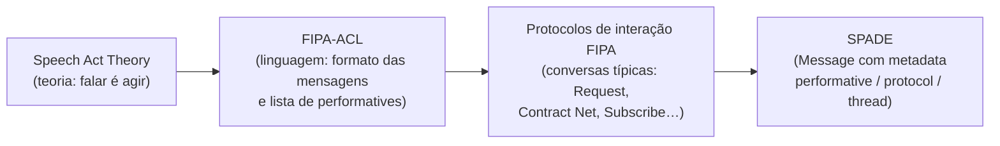
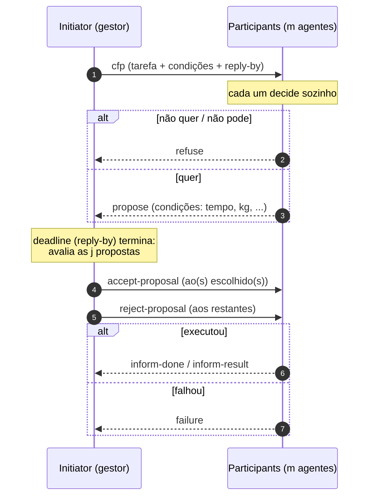
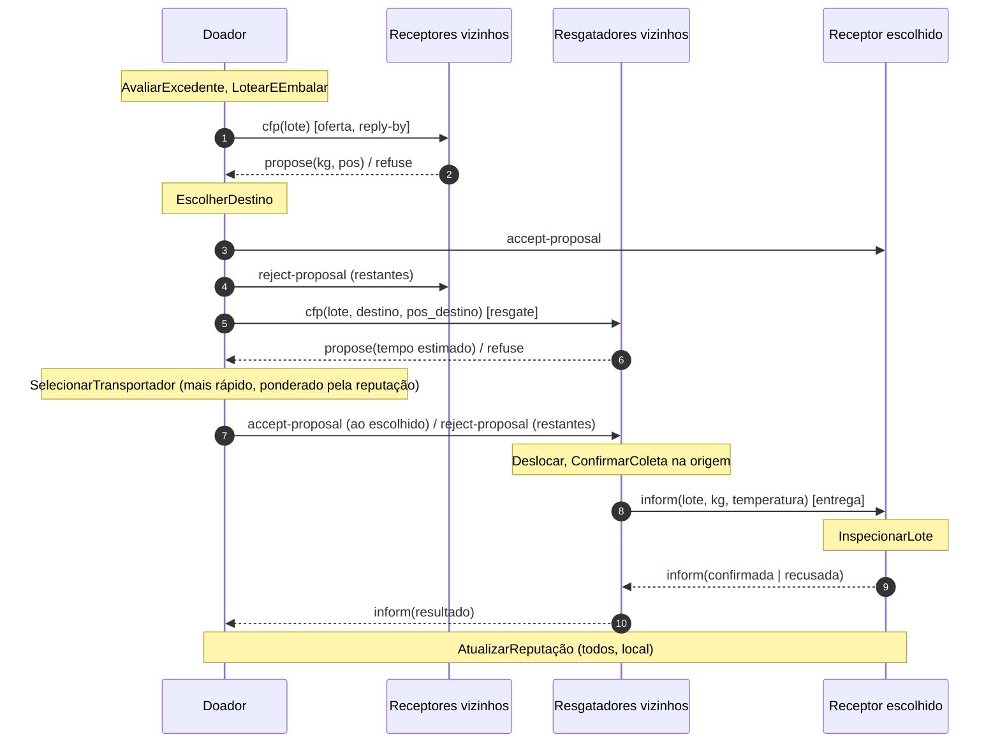

# 3. Interações: Speech Acts, FIPA-ACL e Contract Net

> Ponte entre o **modelo de interações preliminar** do Gaia (análise §2.4) e o
> **modelo de interações completo** do design arquitetural. Aqui decidimos
> **como** os protocolos P1–P7 vão ser falados: que mensagens, com que
> *performatives* e segundo que protocolo FIPA.
>
> Fontes: slides *4. Multi-Agent Systems* (ISIA 2025/26), especificações FIPA
> SC00026H (Request), SC00027H (Query), SC00029H (Contract Net), SC00035H
> (Subscribe), SC00036H (Propose), SC00033H/34H (Brokering/Recruiting).
>
> Estado: **proposta para discussão** (⚠️ = decisão do grupo).

---

## 3.1 Os três conceitos, do mais abstrato ao mais concreto



### 3.1.1 Speech Act Theory: falar é uma ação

Austin (1962) e Searle (1969) observaram que muitas frases **não descrevem o
mundo, mudam-no**. Quem diz "peço-te que venhas buscar o pão" não está a dizer
algo verdadeiro ou falso: está a **agir** sobre outra pessoa.

Cada ato de fala tem três aspetos (slide 8):

| Aspeto | O que é | No nosso domínio |
|---|---|---|
| **Locução** | As palavras ditas | "Tenho 12 kg de pão até às 22h. Quem quer?" |
| **Ilocução** | A intenção de quem fala | O doador **pede propostas** (*call for proposals*) |
| **Perlocução** | O efeito real em quem ouve | Um receptor decide responder com uma proposta. **Depende da autonomia do receptor** |

E cada ato divide-se em duas partes:
- **Performative**: o *verbo* que diz o tipo de ato (informar, pedir, propor…);
- **Conteúdo proposicional**: *sobre o quê* (ex.: `oferta(pão, 12kg, 22h00)`).

**Porque é que isto importa em agentes** (slide 6): um objeto não pode recusar
`o1.m1()`. Um agente pode. Por isso os agentes não invocam métodos uns dos
outros: **enviam atos de fala** e o receptor decide o que fazer
(*"objects do it for free, agents do it for money"*). É exatamente o que
queremos: um resgatador pode recusar uma recolha, um armazém pode recusar
um depósito.

### 3.1.2 FIPA-ACL: a linguagem

A **FIPA** (Foundation for Intelligent Physical Agents) normalizou uma
**Agent Communication Language (ACL)**. Uma mensagem ACL tem três camadas
(slide 10):

| Camada | Parâmetros | Para quê |
|---|---|---|
| **Comunicação** (envelope) | `:sender`, `:receiver`, `:reply-to` | Quem fala com quem |
| **Mensagem** (lógica) | **performative**, `:protocol`, `:conversation-id`, `:in-reply-to`, `:reply-by` | Que tipo de ato é e em que conversa se insere |
| **Conteúdo** | `:content`, `:language`, `:ontology` | O que se diz, em que língua e com que vocabulário |

Exemplo no nosso domínio, no formato do slide 11:

```lisp
(cfp
  :sender          restaurante3@localhost
  :receiver        (set ong1@localhost abrigo2@localhost)
  :protocol        fipa-contract-net
  :conversation-id restaurante3-17
  :reply-by        2026-11-19T18:05:00
  :language        json
  :ontology        food-rescue
  :content         "{\"lote\": {\"id\": \"restaurante3-17\", \"categoria\": \"seco\",
                     \"kg\": 12, \"validade_min\": 4320,
                     \"origem\": [2, 1]}}")
```

**Ontologia** (slides 16–18): é o vocabulário partilhado. Se o doador diz
`"categoria": "refrigerado"`, o resgatador tem de saber o que isso implica
(precisa de caixa térmica, no máximo 60 min fora do frio). A nossa ontologia `food-rescue` está
na §3.6.

### 3.1.3 *Performatives* que vamos usar

A biblioteca FIPA tem cerca de 20 *performatives*. Usamos estas:

| Performative | Significado (intenção de quem envia) | Onde usamos |
|---|---|---|
| `cfp` | "Quem quer / quem consegue fazer isto? Mandem propostas" | Anunciar oferta, pedir transporte, distribuir tarefas aos operadores |
| `propose` | "Faço isto nestas condições" | Receptor ou armazém aceita o lote; resgatador oferece-se; operador aceita a tarefa |
| `refuse` | "Não faço" | Receptor sem necessidade, resgatador ocupado ou sem caixa térmica, zona do armazém cheia ou avariada |
| `accept-proposal` | "Aceito a tua proposta" (o proponente fica **comprometido**) | Escolha do receptor ou do resgatador; aceitação de uma entrega |
| `reject-proposal` | "Não aceito a tua proposta" | Os restantes candidatos; entrega reprovada na inspeção |
| `request` | "Peço-te que faças X" | (Opcional) pedir uma tarefa a um operador |
| `agree` | "Comprometo-me a fazer X" | Operador compromete-se com a tarefa |
| `inform` | "Fica a saber que P é verdade" | Entrega concluída, resultado de inspeção |
| `failure` | "Tentei e falhei" | Resgatador desiste depois de aceitar |
| `cancel` | "Já não estou interessado nesta conversa" | Doador cancela a oferta |
| `query-ref` | "Diz-me o valor de X" | (Opcional) pedir reputação a um vizinho |
| `not-understood` | "Não percebi a tua mensagem" | Qualquer altura (mensagem mal formada) |

---

## 3.2 Os protocolos FIPA disponíveis e quais nos servem

Um **protocolo de interação** é uma **conversa típica**: a sequência de
*performatives* que, em conjunto, tem um significado (slide 25). O ficheiro FIPA
da cadeira define estes protocolos:

| Protocolo FIPA | Em uma frase | Usamos? | Porquê |
|---|---|---|---|
| **Request** | A pede a B que faça uma ação; B concorda ou recusa e depois informa o resultado | ✅ | Opcional: tarefa interna ao armazém, sem concorrência |
| **Query** | A pergunta algo a B (`query-if` / `query-ref`) | ✅ opcional | Fora do v1 (a reputação é local; não há troca de testemunhos) |
| **Request-When** | A pede a B que faça algo **quando** uma condição se verificar | ⚠️ talvez | Ex.: "avisa-me quando a zona refrigerada tiver espaço" |
| **Contract Net** | Um gestor anuncia uma tarefa, vários respondem com propostas, o gestor escolhe | ✅ **central** | Escolher receptor **e** escolher resgatador, sem despachante |
| **Iterated Contract Net** | Contract Net com várias rondas de licitação | ⚠️ extensão | Se ninguém servir à 1.ª ronda, relançar com condições revistas |
| **Propose** | A propõe fazer algo; B aceita ou rejeita | ✅ | Passagem de mão na entrega (com inspeção) |
| **Subscribe** | A subscreve alterações de algo em B | ⚠️ alternativa | Receptor subscreve as ofertas de doadores vizinhos |
| **Brokering / Recruiting** | Um intermediário encontra quem responde por nós | ❌ | Seria um **intermediário central** e violaria a regra OS1 (RNF01) |
| **English / Dutch Auction** | Leilões de preço a subir ou a descer | ❌ | Não há preço; o critério é urgência, validade e equidade |

**Argumento para a apresentação:** o Brokering e o Recruiting resolveriam a
descoberta de pares de forma elegante. Rejeitamo-los **conscientemente** porque
o broker seria precisamente o "central dispatcher" que o enunciado proíbe.

---

## 3.3 O Contract Net em detalhe

Originalmente de Smith & Davis (1980); a versão FIPA (SC00029H) acrescenta
`reject-proposal` e a confirmação final.



**Os cinco pontos que importam (e que o professor pode perguntar):**

1. **O gestor envia `cfp` a *m* participantes.** Cada um responde `propose` ou `refuse`.
2. **Há um *deadline*** (`reply-by`). Sem ele, o gestor podia esperar para
   sempre por quem nunca responde. Uma proposta tardia é rejeitada
   automaticamente. É assim que lidamos com **mensagens perdidas** (S3).
3. **A proposta é vinculativa.** Depois do `accept-proposal`, o participante
   fica **comprometido**. Por isso um resgatador que desiste tem de enviar
   `failure`, e isso alimenta a reputação.
4. **O gestor otimiza uma função** (no nosso caso não é preço: é urgência ×
   quantidade ÷ recebido, ou tempo de entrega ÷ reputação).
5. **Cada conversa tem um `conversation-id` único**, e todas as mensagens o
   levam. No SPADE corresponde ao campo `thread` da `Message`.

**Porque é que o Contract Net serve o "sem despachante central":** quem lança
o CNP é **quem tem o lote**. Cada doador (e o armazém, ao oferecer estoque) é gestor das *suas* ofertas. Há tantos
"gestores" quantos itens, e cada um só fala com os vizinhos (regra OS1). A
coordenação **emerge** de muitos leilões locais.

---

## 3.4 Mapeamento: protocolos Gaia → protocolos FIPA

Proposta de design ⚠️: **quem tem o lote é o gestor dos seus Contract Nets**.
O DOADOR desempenha os papéis EMPARELHADOR e ORGANIZADOR DE TRANSPORTE para os
seus próprios lotes, e o ARMAZENADOR faz o mesmo quando volta a oferecer
estoque. O armazém **não decide por ninguém**: responde a ofertas e oferece o
que é seu. Com esta escolha, são 7 protocolos (análise §2.4):

| Gaia (análise §2.4) | Protocolo FIPA | Iniciador → Participante(s) | Sequência de *performatives* |
|---|---|---|---|
| P1 AnunciarNecessidade | **Inform** (ou **Subscribe** ⚠️) | Receptor → doadores e armazém que conhece | inform(necessidade) |
| P2 AnunciarOferta | **Contract Net** `oferta` | Doador ou armazém → receptores e armazém | cfp → propose\|refuse → accept-proposal / reject-proposal. Se o destino desistir depois: **cancel** |
| P3 ContratarResgate | **Contract Net** `resgate` | Doador ou armazém → resgatadores | cfp → propose\|refuse → accept-proposal / reject-proposal → inform(resultado) \| failure |
| P4 ConfirmarColeta | **Propose** `coleta` | Resgatador → doador ou armazém | propose(kg, temperatura medidos) → accept-proposal \| reject-proposal(divergência) |
| P5 EntregarLote | **Propose** `entrega` | Resgatador → receptor ou armazém | inform/propose(lote, kg, temperatura) → accept-proposal \| reject-proposal(motivo) |
| P6 DistribuirTarefas | **Interno** (D7: sem mensagens FIPA) | Armazém → os seus operadores | a tarefa espera por um operador livre com a função certa |
| P7 TratarImprevisto | **Cancel** + novo CNP | quem deteta → partes afetadas | cancel \| failure → o gestor reabre `resgate` ou `oferta` (regra OL2) |

> **No código** ([`../v1/src/`](../v1/src/)), Fatias 1 a 3: estão implementados P2, P3
> e P5 (com `inform` na entrega) e o `cancel` do P2, tanto com o restaurante
> como com o armazém a fazer de doador. P6 é interno ao armazém. Ver `v1/src/README.md`.

**P6 ficou interno (decisão D7).** Como os operadores não são agentes, a
distribuição de tarefas não troca mensagens FIPA: o armazém tem os seus
operadores (cada um com as funções que sabe fazer) e uma tarefa espera até
haver um livre que a saiba fazer. Se houver tempo, os operadores podem passar
a agentes e P6 volta a ser um Contract Net `tarefa`.

---

## 3.5 Diagramas de sequência (estilo AUML)

> Para o relatório final, estes diagramas devem ser redesenhados em **AUML**
> (Odell et al., 2001, que está nos documentos do projeto). O Mermaid aproxima
> a notação: `alt` = escolha exclusiva (o losango ◇ do AUML), `loop` =
> repetição, `par` = paralelo.

### 3.5.1 Caso feliz: um lote do doador até ao receptor



### 3.5.2 Via armazém: depósito, trabalho dos operadores e nova oferta

```mermaid
sequenceDiagram
    autonumber
    participant D as Doador
    participant A as Armazém
    participant O as Operadores (internos)
    participant V as Resgatador
    participant R as Receptores

    D->>A: cfp(lote) [oferta]
    alt zona cheia, avariada ou sem operador previsto
        A-->>D: refuse(motivo)
    else há espaço
        A-->>D: propose(zona, kg) (reserva a vaga)
        D->>A: accept-proposal
    end
    D->>V: cfp [resgate] ... accept-proposal
    V->>A: inform(lote, kg, temperatura) [entrega]
    Note over A: InspecionarLote
    A-->>V: inform(confirmada)
    V-->>D: inform(resultado)
    Note over A,O: interno (D7): o lote espera na doca por um operador<br/>livre que saiba "receber"; frio > 60 min na doca = descartado

    Note over A,O: em cada ciclo: "controlar" descarta o que expirou
    Note over A: GerirInventário: o armazém passa a ser Iniciador
    A->>R: cfp(item do estoque) [oferta]
    R-->>A: propose / refuse
    A->>R: accept-proposal
    Note over A,O: interno: "preparar" o pedido
    A->>V: cfp ... accept-proposal [resgate] (o armazém é o gestor)
```

### 3.5.3 Falhas: resgatador desiste e zona avariada

```mermaid
sequenceDiagram
    autonumber
    participant D as Doador
    participant R as Receptores
    participant V1 as Resgatador 1
    participant V2 as Resgatador 2
    participant A as Armazém

    D->>R: cfp(lote)
    R-->>D: propose
    D->>R: accept-proposal
    D->>V1: cfp [resgate]
    V1-->>D: propose
    D->>V1: accept-proposal
    alt desiste e avisa
        V1-->>D: failure("cancelado")
    else não aparece (no-show)
        Note over D: reply-by expira sem inform → DetetarAusência
    end
    Note over D: reputação(V1) desce; regra OL2: realocar
    D->>V2: cfp [resgate] (nova ronda)
    V2-->>D: propose
    D->>V2: accept-proposal
    V2->>R: inform(lote) [entrega]
    R-->>V2: inform(confirmada)
    V2-->>D: inform(resultado)

    Note over A: a zona refrigerada avaria (S3): TratarImprevisto
    A->>R: cfp(estoque refrigerado) [oferta] (de imediato)
    Note over A: sem destino a tempo → DescartarVencidos
```

---

## 3.6 Ontologia `food-rescue` e esquemas de mensagens

Conceitos (o vocabulário partilhado):

| Conceito | Atributos | Valores |
|---|---|---|
| `Lote` | id, doador, categoria, kg, validade (min), origem, janela, tempoForaFrio, estado | categoria ∈ {seco, refrigerado, congelado} |
| `Necessidade` | categoriasAceites, kgPretendidos, janela | — |
| `Zona` | tipo, capacidadeKg, ocupadoKg, temperatura, estado | tipo = categoria; estado ∈ {ok, avariada} |
| `Tarefa` | id, tipo, lote, duração, prazo | tipo ∈ {receber, controlar, preparar} |
| `PropostaTransporte` | tempoMin, riscoFrio | — |
| `Inspeção` | loteId, resultado, motivo | resultado ∈ {ok, expirado, frio, rótulo, kg} |

Esquemas de conteúdo (JSON, `:language json`). Os nomes de campo seguem os do
código em `v1/src/` (Fatia 1); onde ainda não há código, é a proposta.

```jsonc
// oferta · cfp  (Doador ou Armazém → Receptores e Armazém)
{ "lote": { "id": "restaurante1-L2", "doador": "restaurante1@localhost",
            "categoria": "refrigerado", "kg": 15, "validade_min": 360,
            "origem": [2, 3] } }

// oferta · propose  (Receptor → quem ofereceu). O armazém acrescenta a zona.
{ "kg": 15, "pos": [8, 7] }                    // armazém: { "kg": 15, "zona": "refrigerado" }

// oferta · refuse
{ "motivo": "não preciso" }

// resgate · cfp  (quem tem o lote → Resgatadores)
{ "lote": { "...": "..." }, "destino": "ong1@localhost", "pos_destino": [8, 7] }

// resgate · propose  (Resgatador)
{ "tempo_min": 40.0 }                          // futuro: + "risco_frio"

// resgate · refuse | failure
{ "motivo": "sem caixa térmica" }              // ou "ocupado", "acima da capacidade"

// entrega · inform  (Resgatador → Receptor ou Armazém)
{ "lote": { "...": "..." }, "temperatura_c": 3 }

// entrega · inform  (resposta)
{ "resultado": "confirmada" }                  // ou { "resultado": "recusada", "motivo": "..." }

// resgate · inform  (Resgatador → quem ofereceu; fecha o Contract Net)
{ "resultado": "confirmada" }

// No estoque, o item tem um id novo ("<lote>-A"), para as conversas do armazém
// como doador não se misturarem com as do lote original.
// oferta · cfp  (Armazém → Receptores)   [Fatia 3]
{ "lote": { "id": "restaurante1-L3-A", "doador": "armazem1@localhost",
            "origem": [6, 6], "categoria": "congelado", "kg": 10, "...": "..." } }
```

---

## 3.7 Como isto fica no SPADE

| Parâmetro FIPA-ACL | SPADE (`spade.message.Message`) |
|---|---|
| performative | `msg.set_metadata("performative", "cfp")` |
| `:sender` / `:receiver` | `msg.sender` / `msg.to` (JIDs, ex.: `restaurante3@localhost`) |
| `:conversation-id` | `msg.thread` |
| `:protocol` | `msg.set_metadata("protocol", "fipa-contract-net")` |
| `:ontology` | `msg.set_metadata("ontology", "food-rescue")` |
| `:language` | `msg.set_metadata("language", "json")` |
| `:content` | `msg.body` (texto: o JSON serializado) |
| `:reply-by` | Não existe nativamente: `await self.receive(timeout=…)` no comportamento que espera as respostas |

E para receber só as mensagens certas, um `Template` filtra por estes campos:

```python
from spade.template import Template
t = Template()
t.set_metadata("performative", "cfp")
t.set_metadata("protocol", "fipa-contract-net")
self.add_behaviour(ResponderOferta(), t)   # este comportamento só recebe cfp do CNP
```

O SPADE não traz o Contract Net pronto (o JADE traz). Vamos ter de o
implementar com comportamentos: `OneShotBehaviour`, ou uma
`FSMBehaviour` (máquina de estados), para o Iniciador, e uma
`CyclicBehaviour` para os Participantes.

**Como está na Fatia 1** ([`../v1/src/mensagens.py`](../v1/src/mensagens.py)). Os
metadados usam nomes simples: `protocolo` (`oferta`, `resgate`, `entrega`),
`lote` (o `conversation-id`), `ontologia` e uma **`fase`** (`pedido` ou
`resposta`). A `fase` existe porque o SPADE entrega cada mensagem a **todos** os
comportamentos cujo `Template` combina; com ela, a *Inbox* geral de cada agente
só vê pedidos e o comportamento que gere um lote só vê as respostas desse lote.
O `reply-by` é o parâmetro `prazo_s` de `esperar_respostas`.

---

## 3.8 Decisões em aberto ⚠️

| # | Questão | Proposta | Alternativa |
|---|---|---|---|
| I1 | Quem é gestor dos Contract Nets | Quem tem o lote: o doador, ou o armazém ao oferecer estoque | O receptor lança CNP para pedir alimento |
| I2 | AnunciarNecessidade | Mensagem `inform` periódica aos que conhece | Subscribe (o receptor subscreve doadores vizinhos) |
| I3 | Uma ou várias rondas | Contract Net simples, relançado se falhar (regra OL2) | Iterated Contract Net |
| I4 | Duração do `reply-by` | ~3 s reais por ronda (na Fatia 1, `PRAZO_RESPOSTAS_S`) | Adaptativa à urgência do lote |
| I5 | Vizinhança (quem recebe o `cfp`) | ✅ Restaurante: receptores a `RAIO_DOADOR_KM` (10 km) + armazéns; armazém: todos os receptores | Os *k* mais próximos |
| I6 | P6 DistribuirTarefas | ✅ Interno ao armazém (D7), sem mensagens | Contract Net com operadores agentes (extra) |
| I7 | Do armazém ao receptor | ✅ Resgatador, via `resgate` com o armazém como gestor | O receptor retira por conta própria |

## Referências

- Austin, J. L. (1962). *How to Do Things with Words*. Oxford University Press.
- Searle, J. R. (1969). *Speech Acts*. Cambridge University Press.
- FIPA (2002). *Contract Net Interaction Protocol Specification* (SC00029H); *Request* (SC00026H); *Query* (SC00027H); *Subscribe* (SC00035H); *Propose* (SC00036H); *Brokering* (SC00033H).
- Smith, R. G. (1980). The Contract Net Protocol. *IEEE Transactions on Computers*, C-29(12), 1104–1113.
- Odell, J., Van Dyke Parunak, H., & Bauer, B. (2001). Representing Agent Interaction Protocols in UML. *AOSE*, Springer, 121–140.
- Wooldridge, M. (2009). *An Introduction to MultiAgent Systems*, 2.ª ed., cap. 6–7.
- Rossetti, R., Costa, A., & Cardoso, H. L. (2025). *4. Multi-Agent Systems*, slides ISIA.
