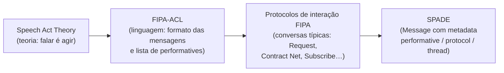
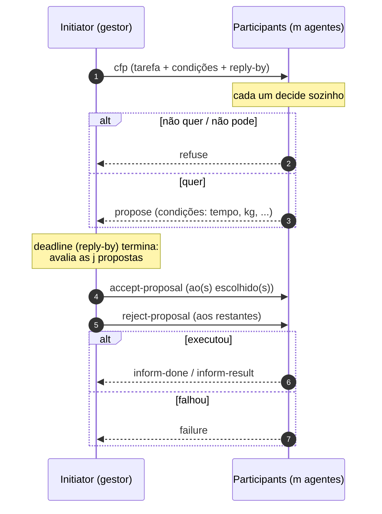
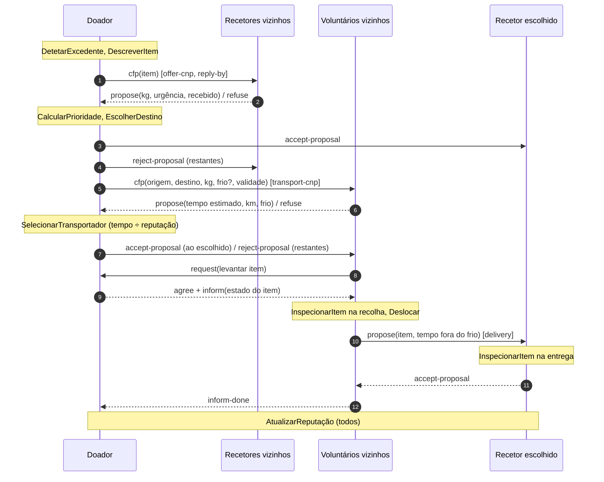
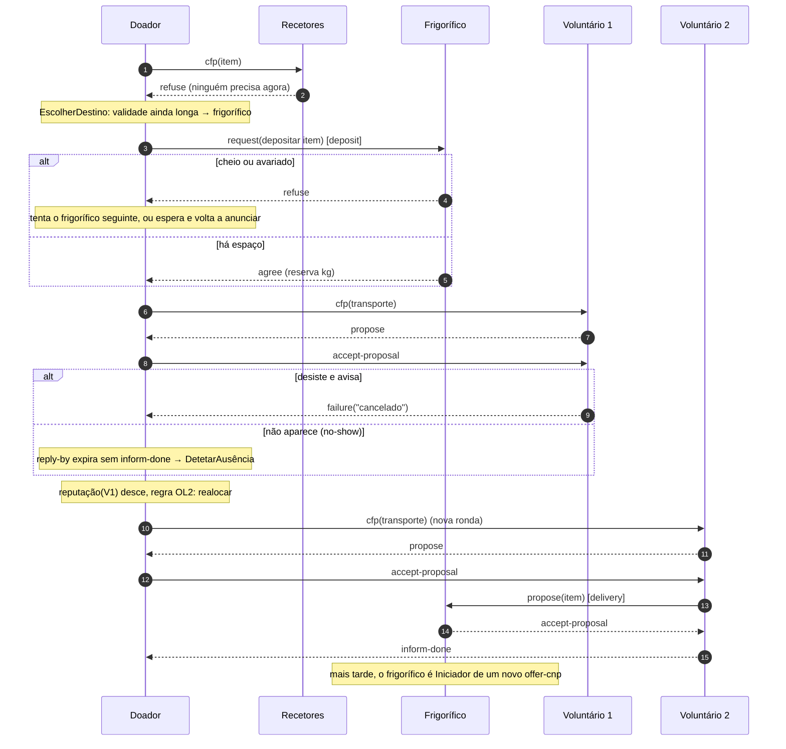

# 3. Interações: Speech Acts, FIPA-ACL e Contract Net

> Ponte entre o **modelo de interações preliminar** do Gaia (análise §2.4) e o
> **modelo de interações completo** do design arquitetural. Aqui decidimos
> **como** os protocolos P1–P14 vão ser falados: que mensagens, com que
> *performatives* e segundo que protocolo FIPA.
>
> Fontes: slides *4. Multi-Agent Systems* (ISIA 2025/26), especificações FIPA
> SC00026H (Request), SC00027H (Query), SC00029H (Contract Net), SC00035H
> (Subscribe), SC00036H (Propose), SC00033H/34H (Brokering/Recruiting).
>
> Estado: **proposta para discussão** (⚠️ = decisão do grupo).

---

## 3.1 Os três conceitos, do mais abstrato ao mais concreto



### 3.1.1 Speech Act Theory: falar é uma ação

Austin (1962) e Searle (1969) observaram que muitas frases **não descrevem o
mundo, mudam-no**. Quem diz "peço-te que venhas buscar o pão" não está a dizer
algo verdadeiro ou falso: está a **agir** sobre outra pessoa.

Cada ato de fala tem três aspetos (slide 8):

| Aspeto | O que é | No nosso domínio |
|---|---|---|
| **Locução** | As palavras ditas | "Tenho 12 kg de pão até às 22h. Quem quer?" |
| **Ilocução** | A intenção de quem fala | O doador **pede propostas** (*call for proposals*) |
| **Perlocução** | O efeito real em quem ouve | Um recetor decide responder com uma proposta. **Depende da autonomia do recetor** |

E cada ato divide-se em duas partes:
- **Performative**: o *verbo* que diz o tipo de ato (informar, pedir, propor…);
- **Conteúdo proposicional**: *sobre o quê* (ex.: `oferta(pão, 12kg, 22h00)`).

**Porque é que isto importa em agentes** (slide 6): um objeto não pode recusar
`o1.m1()`. Um agente pode. Por isso os agentes não invocam métodos uns dos
outros: **enviam atos de fala** e o recetor decide o que fazer
(*"objects do it for free, agents do it for money"*). É exatamente o que
queremos: um voluntário pode recusar uma recolha, um frigorífico pode recusar
um depósito.

### 3.1.2 FIPA-ACL: a linguagem

A **FIPA** (Foundation for Intelligent Physical Agents) normalizou uma
**Agent Communication Language (ACL)**. Uma mensagem ACL tem três camadas
(slide 10):

| Camada | Parâmetros | Para quê |
|---|---|---|
| **Comunicação** (envelope) | `:sender`, `:receiver`, `:reply-to` | Quem fala com quem |
| **Mensagem** (lógica) | **performative**, `:protocol`, `:conversation-id`, `:in-reply-to`, `:reply-by` | Que tipo de ato é e em que conversa se insere |
| **Conteúdo** | `:content`, `:language`, `:ontology` | O que se diz, em que língua e com que vocabulário |

Exemplo no nosso domínio, no formato do slide 11:

```lisp
(cfp
  :sender          donor3@localhost
  :receiver        (set recipient1@localhost recipient4@localhost)
  :protocol        fipa-contract-net
  :conversation-id oferta-donor3-17
  :reply-by        2026-11-19T18:05:00
  :language        json
  :ontology        food-rescue
  :content         "{\"item\": {\"id\": \"donor3-17\", \"tipo\": \"padaria\",
                     \"kg\": 12, \"classe\": \"ambiente\",
                     \"validade\": \"22:00\", \"posicao\": [2, 1]}}")
```

**Ontologia** (slides 16–18): é o vocabulário partilhado. Se o doador diz
`"classe": "refrigerado"`, o voluntário tem de saber o que isso implica
(precisa de frio, no máximo 60 min fora). A nossa ontologia `food-rescue` está
na §3.6.

### 3.1.3 *Performatives* que vamos usar

A biblioteca FIPA tem cerca de 20 *performatives*. Usamos estas:

| Performative | Significado (intenção de quem envia) | Onde usamos |
|---|---|---|
| `cfp` | "Quem quer / quem consegue fazer isto? Mandem propostas" | Anunciar excedente, pedir transporte |
| `propose` | "Faço isto nestas condições" | Recetor pede o item; voluntário oferece-se; entrega |
| `refuse` | "Não faço" | Recetor sem necessidade, voluntário ocupado, frigorífico cheio |
| `accept-proposal` | "Aceito a tua proposta" (o proponente fica **comprometido**) | Escolha do recetor ou do voluntário; aceitação de uma entrega |
| `reject-proposal` | "Não aceito a tua proposta" | Os restantes candidatos; entrega reprovada na inspeção |
| `request` | "Peço-te que faças X" | Pedir depósito num frigorífico |
| `agree` | "Comprometo-me a fazer X" | Frigorífico reserva espaço |
| `inform` | "Fica a saber que P é verdade" | Entrega concluída, resultado de inspeção |
| `failure` | "Tentei e falhei" | Voluntário desiste depois de aceitar |
| `cancel` | "Já não estou interessado nesta conversa" | Doador cancela a oferta |
| `query-ref` | "Diz-me o valor de X" | (Opcional) pedir reputação a um vizinho |
| `not-understood` | "Não percebi a tua mensagem" | Qualquer altura (mensagem mal formada) |

---

## 3.2 Os protocolos FIPA disponíveis e quais nos servem

Um **protocolo de interação** é uma **conversa típica**: a sequência de
*performatives* que, em conjunto, tem um significado (slide 25). O ficheiro FIPA
da cadeira define estes protocolos:

| Protocolo FIPA | Em uma frase | Usamos? | Porquê |
|---|---|---|---|
| **Request** | A pede a B que faça uma ação; B concorda ou recusa e depois informa o resultado | ✅ | Depósito no frigorífico (1 para 1, sem concorrência) |
| **Query** | A pergunta algo a B (`query-if` / `query-ref`) | ✅ opcional | Partilha de reputação (P14) |
| **Request-When** | A pede a B que faça algo **quando** uma condição se verificar | ⚠️ talvez | Ex.: "avisa-me quando o frigorífico tiver espaço" |
| **Contract Net** | Um gestor anuncia uma tarefa, vários respondem com propostas, o gestor escolhe | ✅ **central** | Escolher recetor **e** escolher voluntário, sem despachante |
| **Iterated Contract Net** | Contract Net com várias rondas de licitação | ⚠️ extensão | Se ninguém servir à 1.ª ronda, relançar com condições revistas |
| **Propose** | A propõe fazer algo; B aceita ou rejeita | ✅ | Passagem de mão na entrega (com inspeção) |
| **Subscribe** | A subscreve alterações de algo em B | ⚠️ alternativa | Recetor subscreve as ofertas de doadores vizinhos |
| **Brokering / Recruiting** | Um intermediário encontra quem responde por nós | ❌ | Seria um **intermediário central** e violaria a regra OS1 (RNF01) |
| **English / Dutch Auction** | Leilões de preço a subir ou a descer | ❌ | Não há preço; o critério é urgência, validade e equidade |

**Argumento para a apresentação:** o Brokering e o Recruiting resolveriam a
descoberta de pares de forma elegante. Rejeitamo-los **conscientemente** porque
o broker seria precisamente o "central dispatcher" que o enunciado proíbe.

---

## 3.3 O Contract Net em detalhe

Originalmente de Smith & Davis (1980); a versão FIPA (SC00029H) acrescenta
`reject-proposal` e a confirmação final.



**Os cinco pontos que importam (e que o professor pode perguntar):**

1. **O gestor envia `cfp` a *m* participantes.** Cada um responde `propose` ou `refuse`.
2. **Há um *deadline*** (`reply-by`). Sem ele, o gestor podia esperar para
   sempre por quem nunca responde. Uma proposta tardia é rejeitada
   automaticamente. É assim que lidamos com **mensagens perdidas** (S3).
3. **A proposta é vinculativa.** Depois do `accept-proposal`, o participante
   fica **comprometido**. Por isso um voluntário que desiste tem de enviar
   `failure`, e isso alimenta a reputação.
4. **O gestor otimiza uma função** (no nosso caso não é preço: é urgência ×
   quantidade ÷ recebido, ou tempo de entrega ÷ reputação).
5. **Cada conversa tem um `conversation-id` único**, e todas as mensagens o
   levam. No SPADE corresponde ao campo `thread` da `Message`.

**Porque é que o Contract Net serve o "sem despachante central":** quem lança
o CNP é **quem tem o item**. Cada doador é gestor das *suas* ofertas. Há tantos
"gestores" quantos itens, e cada um só fala com os vizinhos (regra OS1). A
coordenação **emerge** de muitos leilões locais.

---

## 3.4 Mapeamento: protocolos Gaia → protocolos FIPA

Proposta de design ⚠️: **o DOADOR desempenha os papéis EMPARELHADOR e
ORGANIZADOR DE TRANSPORTE para os seus próprios itens** (o mesmo vale para o
ARMAZENADOR quando volta a oferecer stock). Com esta escolha:

| Gaia (análise §2.4) | Protocolo FIPA | Iniciador → Participante(s) | Sequência de *performatives* |
|---|---|---|---|
| P1 AnunciarExcedente + P3 AtribuirDestino | **Contract Net** `offer-cnp` | Doador → recetores vizinhos | cfp → propose\|refuse → accept-proposal / reject-proposal |
| P2 DeclararNecessidade | *(absorvido)* | — | A necessidade vai **dentro** do `propose` do recetor. Alternativa ⚠️: **Subscribe** |
| P4 PedirDepósito | **Request** `deposit` | Doador → frigorífico | request → agree\|refuse |
| P5 ConfirmarDestino | *(interno)* | — | Deixa de ser mensagem: o doador é o próprio EMPARELHADOR |
| P6 PedirTransporte + P7 ConfirmarTransporte | **Contract Net** `transport-cnp` | Doador → voluntários vizinhos | cfp → propose\|refuse → accept / reject |
| P10 ConfirmarEntrega | (fim do Contract Net) | Voluntário → doador | inform-done |
| P11 DesistirTransporte | (fim do Contract Net) | Voluntário → doador | failure → o doador lança **novo** `transport-cnp` (regra OL2) |
| P8 EntregarNaRecolha | **Request** | Voluntário → doador | request(levantar item) → agree + inform(estado do item) |
| P9 EntregarItem | **Propose** `delivery` | Voluntário → recetor/frigorífico | propose(item, tempo fora do frio) → accept-proposal\|reject-proposal(motivo) |
| P12 CancelarOferta | **Cancel meta-protocol** | Doador → quem tem reserva | cancel → inform-done\|failure |
| P13 ReportarInspeção | **inform** simples | Verificador → avaliador / doador | inform(resultado) |
| P14 PartilharReputação | **Query** | Avaliador → avaliador vizinho | query-ref → inform-result\|refuse |

---

## 3.5 Diagramas de sequência (estilo AUML)

> Para o relatório final, estes diagramas devem ser redesenhados em **AUML**
> (Odell et al., 2001, que está nos documentos do projeto). O Mermaid aproxima
> a notação: `alt` = escolha exclusiva (o losango ◇ do AUML), `loop` =
> repetição, `par` = paralelo.

### 3.5.1 Caso feliz: um item do doador até ao recetor



### 3.5.2 Falhas: voluntário desiste e frigorífico como plano B



---

## 3.6 Ontologia `food-rescue` e esquemas de mensagens

Conceitos (o vocabulário partilhado):

| Conceito | Atributos | Valores |
|---|---|---|
| `Item` | id, doador, tipo, kg, classe, validade, posição, tempoForaFrio, rótuloOk | tipo ∈ {padaria, fruta-legumes, prato-pronto, lacticínio}; classe ∈ {ambiente, refrigerado} |
| `Necessidade` | tiposAceites, kgPretendidos, urgência, recebidoHoje | urgência ∈ {1, 2, 3} |
| `Transporte` | origem, destino, kg, precisaFrio, prazo | — |
| `PropostaTransporte` | tempoEstimado, km, temFrio | — |
| `Inspeção` | itemId, resultado, motivo | resultado ∈ {ok, expirado, frio, rótulo} |

Esquemas de conteúdo (JSON, `:language json`):

```jsonc
// offer-cnp · cfp  (Doador → Recetores)
{ "round": "R1", "item": { "id": "donor3-17", "tipo": "padaria", "kg": 12,
  "classe": "ambiente", "validade": 840, "posicao": [2, 1] } }

// offer-cnp · propose  (Recetor → Doador)
{ "round": "R1", "kgPretendidos": 12, "urgencia": 3, "recebidoHoje": 40.5,
  "posicao": [4, 3] }

// transport-cnp · cfp  (Doador → Voluntários)
{ "round": "T1", "item": { "...": "..." }, "destino": "recipient4@localhost",
  "posDestino": [4, 3] }

// transport-cnp · propose  (Voluntário → Doador)
{ "round": "T1", "tempoEstimado": 38.5, "km": 9, "temFrio": false }

// transport-cnp · failure  (Voluntário → Doador)
{ "round": "T1", "motivo": "cancelado" }

// delivery · propose  (Voluntário → Recetor)
{ "item": { "...": "..." }, "tempoForaFrio": 25, "voluntario": "rescuer7@localhost" }

// delivery · reject-proposal  (Recetor → Voluntário)
{ "itemId": "donor3-17", "motivo": "expirado" }
```

---

## 3.7 Como isto fica no SPADE

| Parâmetro FIPA-ACL | SPADE (`spade.message.Message`) |
|---|---|
| performative | `msg.set_metadata("performative", "cfp")` |
| `:sender` / `:receiver` | `msg.sender` / `msg.to` (JIDs, ex.: `donor3@localhost`) |
| `:conversation-id` | `msg.thread` |
| `:protocol` | `msg.set_metadata("protocol", "fipa-contract-net")` |
| `:ontology` | `msg.set_metadata("ontology", "food-rescue")` |
| `:language` | `msg.set_metadata("language", "json")` |
| `:content` | `msg.body` (texto: o JSON serializado) |
| `:reply-by` | Não existe nativamente: `await self.receive(timeout=…)` no comportamento que espera as respostas |

E para receber só as mensagens certas, um `Template` filtra por estes campos:

```python
from spade.template import Template
t = Template()
t.set_metadata("performative", "cfp")
t.set_metadata("protocol", "fipa-contract-net")
self.add_behaviour(ResponderOferta(), t)   # este comportamento só recebe cfp do CNP
```

O SPADE não traz o Contract Net pronto (o JADE traz). Vamos ter de o
implementar com comportamentos: `OneShotBehaviour`, ou uma
`FSMBehaviour` (máquina de estados), para o Iniciador, e uma
`CyclicBehaviour` para os Participantes.

---

## 3.8 Decisões em aberto ⚠️

| # | Questão | Proposta | Alternativa |
|---|---|---|---|
| I1 | Quem é gestor dos Contract Nets | O doador, para os seus itens | O recetor lança CNP para pedir alimento |
| I2 | DeclararNecessidade | Dentro do `propose` | Subscribe (o recetor subscreve doadores vizinhos) |
| I3 | Uma ou várias rondas | Contract Net simples, relançado se falhar | Iterated Contract Net |
| I4 | Duração do `reply-by` | ~0,5 s reais (10 min simulados) | Adaptativa à urgência do item |
| I5 | Vizinhança (quem recebe o `cfp`) | Raio fixo em km | Os *k* mais próximos |

## Referências

- Austin, J. L. (1962). *How to Do Things with Words*. Oxford University Press.
- Searle, J. R. (1969). *Speech Acts*. Cambridge University Press.
- FIPA (2002). *Contract Net Interaction Protocol Specification* (SC00029H); *Request* (SC00026H); *Query* (SC00027H); *Subscribe* (SC00035H); *Propose* (SC00036H); *Brokering* (SC00033H).
- Smith, R. G. (1980). The Contract Net Protocol. *IEEE Transactions on Computers*, C-29(12), 1104–1113.
- Odell, J., Van Dyke Parunak, H., & Bauer, B. (2001). Representing Agent Interaction Protocols in UML. *AOSE*, Springer, 121–140.
- Wooldridge, M. (2009). *An Introduction to MultiAgent Systems*, 2.ª ed., cap. 6–7.
- Rossetti, R., Costa, A., & Cardoso, H. L. (2025). *4. Multi-Agent Systems*, slides ISIA.
